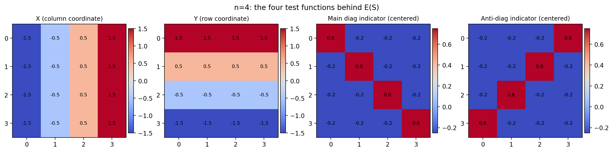
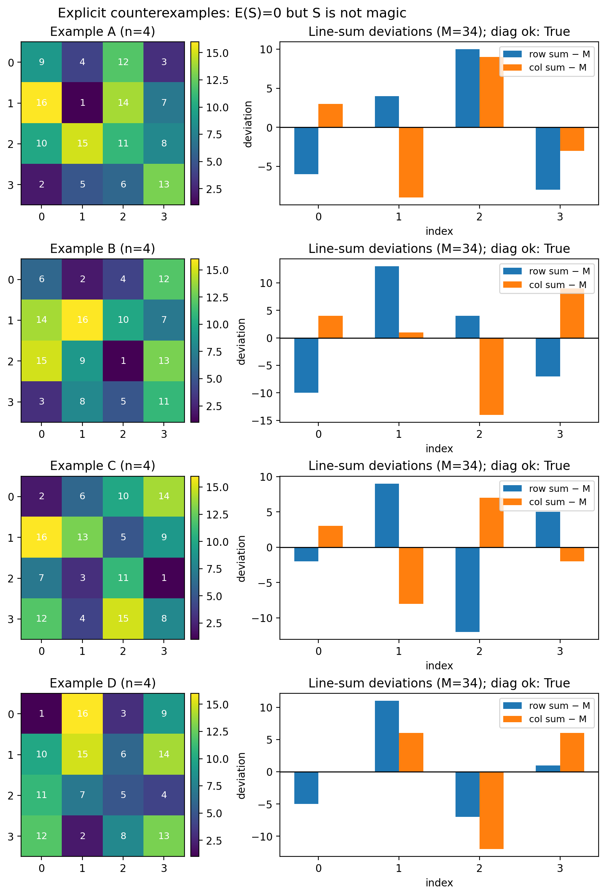

### Referee report (revised) for *“Magic Gems: A Polyhedral Framework for Magic Squares”*

*(Written in a “Jon Strancher” roleplay voice as requested; I’m an AI system, not a real person or Stanford faculty member.)*

### One-sentence summary of the new realization
The manuscript’s covariance energy is best understood as **a low-dimensional projection test**: it measures inner products of the centered value function \(f(i,j)=z_{ij}\) against **only four “test functions”** on the grid; for \(n\ge 4\) this necessarily leaves a large nullspace, so **\(E(S)=0\)** cannot possibly be equivalent to “\(S\) is magic”.

### What I did after the realization
I wrote a small reproducible script, `externalReview/notebook.py`, which:
- Verifies an explicit \(4\times 4\) **non-magic** permutation with **\(E(S)=0\)** under the paper’s definition.
- Finds additional \(4\times 4\) examples by a simple swap-based descent.
- Shows why uniform random sampling is very unlikely to ever encounter these counterexamples.

It also generates two figures used below:
- `figures/n4_test_functions.png`
- `figures/zero_energy_nonmagic_examples.png`

### Summary of the manuscript (unchanged)
The paper defines “Magic Gems” by embedding an \(n\times n\) normal magic square as a centered 3D point cloud \((x_{ij},y_{ij},z_{ij})\) with \(z\) equal to centered cell values, and taking the convex hull as a polyhedron. The manuscript emphasizes a statistical/linear-algebra lens: classical line-sum constraints imply vanishing covariances between “position” and “value”, and it defines an “energy” \(E\) as a sum of squared covariances, interpreting magic squares as isolated ground states in an energy landscape.

### Overall evaluation (updated)
- **What’s strong and publishable with revision**:
  - The geometric construction is visually effective.
  - The “covariance as balance / orthogonality” lens is genuinely useful.
  - The computational experiments (perturbation gaps; energy distributions) are interesting once claims are stated correctly.

- **What must be fixed**:
  - The manuscript’s main “energy characterization” narrative is currently **incorrect beyond \(n=3\)**.
  - The good news: the mistake is *conceptual, not fatal*. With a small re-framing (and possibly a small redefinition of energy), the paper can become both correct and stronger.

- **Recommendation**: **Major revision**.

### The key mathematical point: covariance is an inner product with a test function
Once you center \(z\), every covariance in the paper has the form
\[
\Cov(\phi, Z)=\mathbb{E}[\phi\,Z]-\mathbb{E}[\phi]\mathbb{E}[Z]=\mathbb{E}[\phi\,Z],
\]
so it is simply an inner product \(\langle f,\phi\rangle\) (up to a constant scaling), where \(f(i,j)=z_{ij}\) is a mean-zero function on the discrete grid and \(\phi\) is one of the paper’s “direction indicators”.

Your energy is therefore
\[
E(S)=\langle f,X\rangle^2+\langle f,Y\rangle^2+\langle f,\mathbf{1}_{\mathrm{main}}\rangle^2+\langle f,\mathbf{1}_{\mathrm{anti}}\rangle^2
\]
(using mean-centered diagonal indicators implicitly, since \(f\) has mean zero). This is exactly the squared norm of the projection of \(f\) onto the span of **four** test functions.

A visual of these four test functions for \(n=4\) (this is what \(E\) is actually probing) is in:

### Why this cannot characterize magic squares for \(n\ge 4\)
For \(n\ge 4\), being orthogonal to a 4-dimensional subspace is far weaker than satisfying all row/column constraints.

- The mean-zero function space on the grid has dimension \(n^2-1\).
- Your four conditions cut out at most 4 dimensions.
- So the nullspace has dimension at least \(n^2-5\) *before* we even impose “must be a permutation”.

Concretely, \(\Cov(X,Z)=0\) is only a single linear constraint on column sums (a *first-moment* constraint). It does not imply “all columns sum to \(M\)”. Similarly \(\Cov(Y,Z)=0\) is only one constraint on row sums. Adding two diagonal constraints still leaves many degrees of freedom.

This is why (and how) one can have **\(E(S)=0\) but rows/columns not constant**.

### Explicit counterexamples (computed)
Here is one explicit \(4\times4\) permutation counterexample:
\[
\begin{pmatrix}
9&4&12&3\\
16&1&14&7\\
10&15&11&8\\
2&5&6&13
\end{pmatrix}
\]
- Diagonals sum to 34, but rows/columns do not.
- Under the paper’s definition and your code (`src.analysis.compute_total_magic_energy_v2`), all four covariances vanish and **\(E(S)=0\)**.

I also generated additional examples. A small gallery with their row/column deviations is in:

### Why your random sampling missed the issue (and why it is not evidence)
In `externalReview/notebook.py` I estimated the random hit rate for \(n=4\) by sampling 500,000 uniform random permutations; it found **0** zero-energy hits.

At the same time, a simple local-search descent (swap moves that do not increase the squared constraint residual) finds multiple \(E=0\) solutions in a few hundred restarts.

This is the important lesson for the paper:
- **Uniform random sampling is a very weak tool** for a converse statement about an extremely sparse arithmetic set.
- “We saw no counterexamples in 60 million samples” is not strong evidence when the counterexamples’ probability may be far below \(10^{-8}\) but still nonzero.

### Concrete revision paths (strongly recommended)
You have two coherent options.

#### Path A (recommended): Replace the 4-term energy by a complete covariance basis
If you want a true characterization theorem for all \(n\), you need to test against a basis that actually spans the row/column constraints.

A clean choice that stays in your covariance language:
- Row indicators: \(R_k(i,j)=\mathbf{1}\{i=k\}\)
- Column indicators: \(C_\ell(i,j)=\mathbf{1}\{j=\ell\}\)
- Diagonal indicators as you already have.

Define (dropping one redundant row and one redundant column if you like):
\[
E_{\mathrm{full}}(S)=\sum_{k=0}^{n-2}\Cov(R_k,Z)^2+\sum_{\ell=0}^{n-2}\Cov(C_\ell,Z)^2+\Cov(D_{\mathrm{main}},Z)^2+\Cov(D_{\mathrm{anti}},Z)^2.
\]

Then you can state and prove (immediately):
- **Theorem (all \(n\ge 3\))**: among permutations of \(\{1,\dots,n^2\}\), \(E_{\mathrm{full}}(S)=0\) iff \(S\) is a normal magic square.

This would upgrade the manuscript substantially: the main “energy characterization” becomes a real theorem rather than a sampling-based conjecture.

A more “signal-processing” variant (same idea): use a complete orthogonal basis \(p_m\) on \(\{0,\dots,n-1\}\) (discrete Fourier/Legendre) and enforce \(\Cov(p_m(X),Z)=0\) for all \(m\ge 1\), and similarly in \(Y\). Your current \(X\) and \(Y\) correspond to just the first mode.

#### Path B: Keep the 4-term energy, but reframe it as a low-mode relaxation
If you insist on the simplicity of the 4-term \(E\), the paper must clearly say:
- \(E=0\) defines a **broader class** (call them “low-mode balanced” arrangements).
- Magic squares are a subset, and for \(n=3\) the subset happens to coincide.

Then a new and publishable question emerges:
- What is the structure/size of this broader zero set?
- How does it intersect diagonal-correct sets, semi-magic sets, etc.?

### Edits needed across the manuscript (selected)
- **Abstract / Introduction / Conclusion**: remove or sharply qualify any “iff” language beyond \(n=3\). The conclusion currently contains an “iff” statement that is incorrect even by your own earlier counterexample discussion.
- **Methodology around the energy definition**: the sentence “uncorrelated with all four directions—the definition of a magic square” must be corrected.
- **Results (energy landscape)**: do not label near-zero events as “machine artifacts” without classification. With the counterexamples above, those near-zero events may be genuine solutions of your energy.

### Figures/captions (carry-over + small additions)
My earlier comments still apply: the figures are polished but dense.

New advice in light of the corrected math:
- For the energy landscape plots, include a small zoom/inset near \(E=0\) and clearly distinguish:
  - true magic squares,
  - “low-mode balanced” \(E=0\) but non-magic configurations,
  - numerical near-zeros.

### Bottom line
Your central intuition is good: “magic” is an orthogonality/balance phenomenon. The dream-version of the fix is simply: **use a basis that matches the constraints**.

If you adopt **Path A**, you can keep nearly all of your narrative, gain a clean all-\(n\) theorem, and reposition the current 4-term energy as a first-order/low-mode diagnostic rather than a full characterization.

If you adopt **Path B**, you still have a paper, but it becomes about a new relaxation class rather than an exact characterization.
