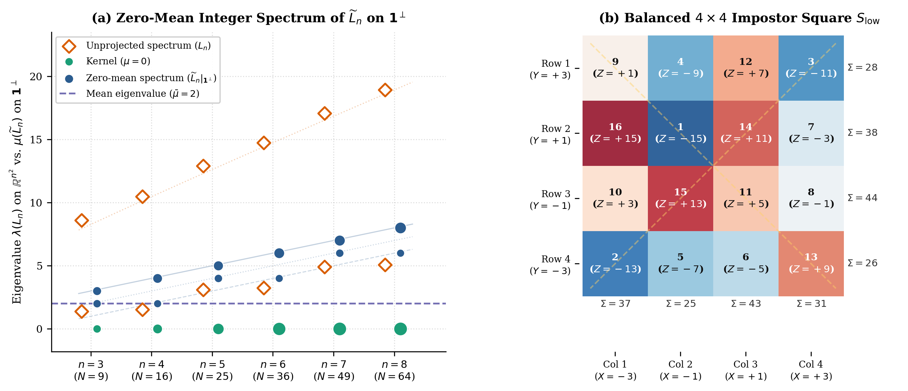
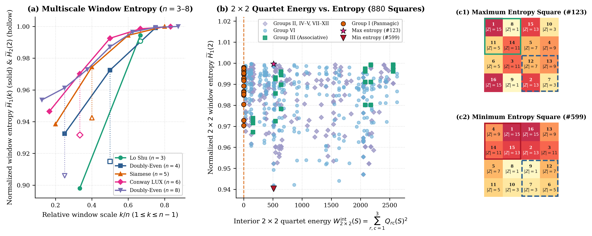
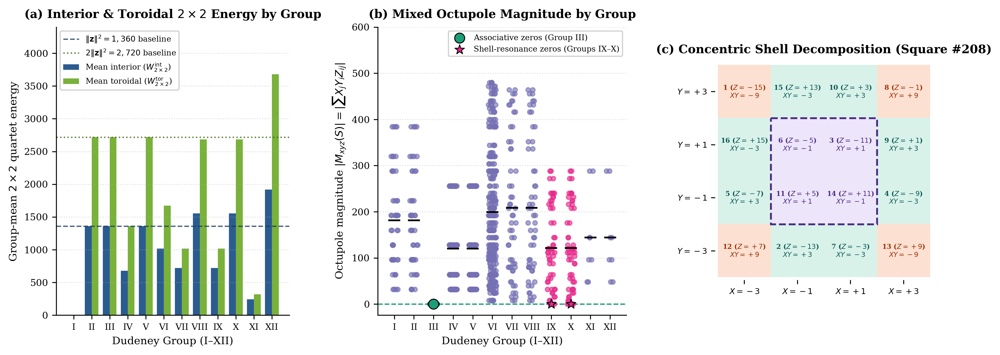
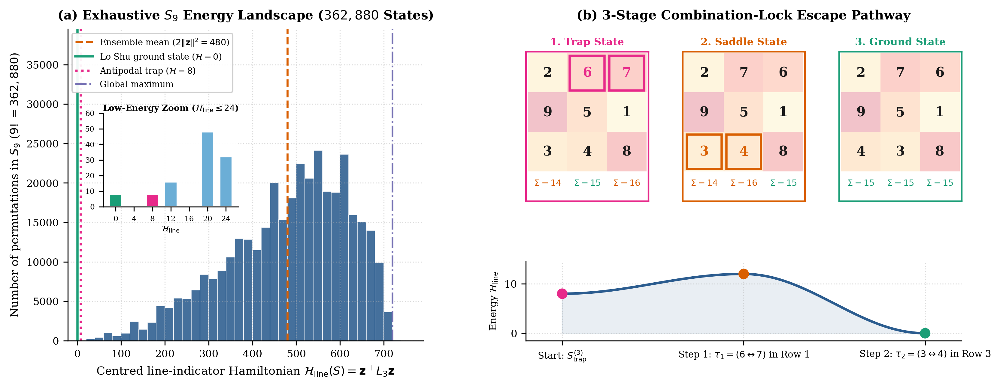
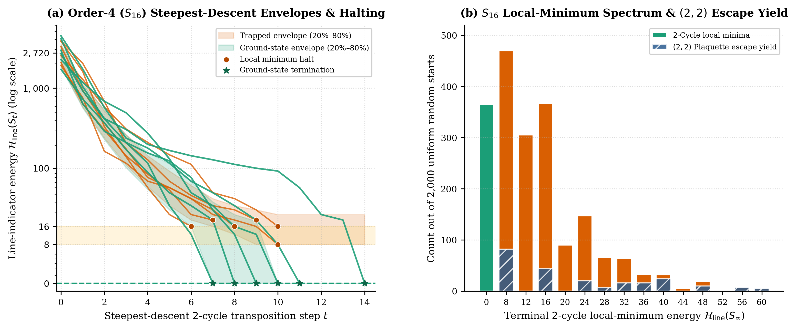
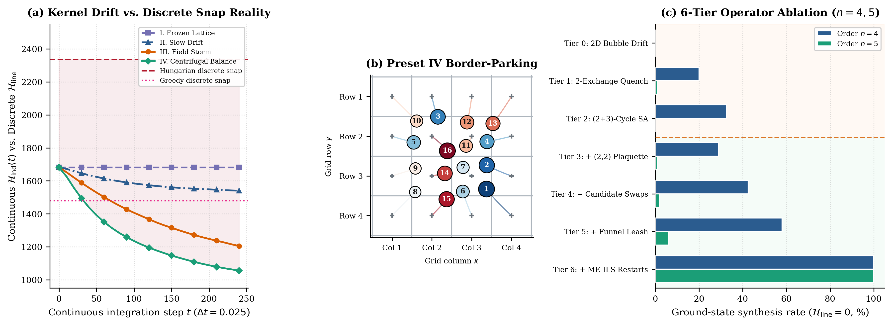
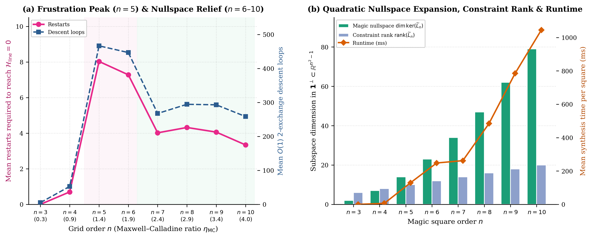
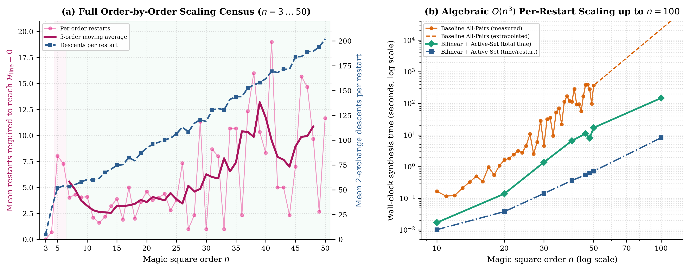
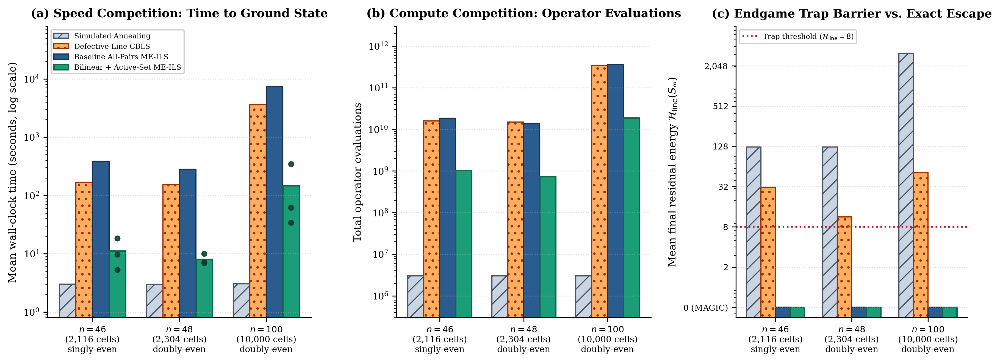

# Can Physical Forces Find a Magic Square? Spectral Energy Landscapes, Conjugate Plaquette Exchanges, and Fast Bilinear Relaxation up to Order $n = 100$

**Kyle Elliott Mathewson**  
*Faculty of Science, University of Alberta*  
`kyle.mathewson@ualberta.ca`

---

## Abstract

If we attach virtual springs to the rows, columns, and diagonals of a scrambled $n\times n$ grid of numbers $1\dots n^2$---or let the numbers float as buoyant "bubbles" in a two-dimensional dish driven by line-sum imbalances---can physical relaxation discover a magic square on its own? Whereas the first three papers of the *Magic Gems* series studied the static polyhedral geometry (Paper I), polynomial moment identities (Paper II), and rigid-body rotational mechanics (Paper III) of completed magic squares, this fourth study and its open-source interactive browser laboratory (`physicalSolver`) investigate the inverse dynamical landscape governed by the quadratic line-sum Hamiltonian $\mathcal{H}_{\mathrm{line}}(S) = \sum_{L\in\mathcal{L}_n} R_L(S)^2 = \mathbf{z}^\top L_n \mathbf{z}$ across the symmetric group $S_{n^2}$ from $n = 3$ up to $n = 100$ ($10{,}000$ cells). Combining exact spectral linear algebra with exhaustive computer censuses and large-scale combinatorial optimization, we establish five principal findings: (1) restricting the Rook's-graph-plus-diagonals operator $L_n = A_n^\top A_n$ to the zero-mean hyperplane $\mathbf{1}^\perp$ collapses its irrational eigenvalues into exact integers with universal mean $\bar{\mu}(\widetilde{L}_n) = 2$ and random-shuffle expectation $\mathbb{E}[\mathcal{H}_{\mathrm{line}}(S)] = \frac{2}{3}n^2(n^4-1)$ (Proposition 2.1), yet balancing 3D plate tilt and main diagonals fixes only $4$ modes out of $2n$, leaving $2n-4$ alternating row and column modes unchecked as demonstrated by an explicit $4\times 4$ "impostor square" $S_{\mathrm{low}}$ at $\mathcal{H}_{\mathrm{line}} = 1{,}584$ (Remark 2.2); (2) inside the ground-state manifold $\mathcal{H}_{\mathrm{line}}(S) = 0$, sliding $k\times k$ window entropies $\widetilde{H}_p(k)$ and a Concentric Shell Quadrupole Identity $M_{xyz}(S) = -8\,Q_{\mathrm{corner}}(S) - 3\,Q_{\mathrm{edge}}(S)$ (Lemma 3.1 and Proposition 3.2) classify all $880$ order-$4$ magic squares, explaining both the $48$ panmagic squares of Dudeney Group I and $8$ anomalous non-associative octupole-zero squares in Groups IX and X whose corner and edge shells cancel in a coprime $(-3k, 8k)$ resonance; (3) across all $9! = 362{,}880$ permutations of $S_9$ (Theorem 4.2), greedy $2$-exchange descent converges to the Lo Shu square from $74.53\%$ of starting shuffles and freezes from the remaining $25.47\%$ in a single dihedral trap orbit $S_{\mathrm{trap}}^{(3)}$ at $\mathcal{H}_{\mathrm{line}} = 8$ that resists all $2$-swaps and all $3$-cycles, but is unlocked in one step by a unique row-preserving $(2,2)$ double swap $(6\leftrightarrow 7)(3\leftrightarrow 4)$ acting as a $4$-cell Kempe chain; (4) in our continuous *Bubble Trinity* simulator, soft 2D Gaussian particles lower their kernel energy $\mathcal{H}_{\mathrm{ind}}(t)$ by $37.5\%$ yet recover $0.0\%$ magic squares under both greedy snapping and exact $O(N^3)$ Hungarian bipartite matching by parking on cell borders to blend amplitudes, whereas our discrete *Multi-Exchange Iterated Local Search (ME-ILS)* engine achieves $100.0\%$ convergence across all $N = 48$ consecutive orders from $n = 3$ to $n = 50$, revealing a sharp frustration peak at $n = 5$ ($8.03$ restarts) followed by an order-invariant nullspace-relief plateau across $n = 6\dots 50$ (median $4.32$ restarts, $\text{IQR} = 2.67\text{--}8.67$, while per-restart descents scale linearly as $3.52\,n + 20.86$, $r = 0.9934$, $p = 6.39\times 10^{-45}$) as $f_{\mathrm{null}}(n) = 1 - 2/(n-1)^2$ of the $(2,2)$ plaquette subspace becomes diagonal-free; and (5) we prove the *Bilinear Plaquette Identity* $\Delta\mathcal{H}_{\mathrm{line}}(p_1, p_2) = \Delta\mathcal{H}_{\mathrm{line}}(p_1) + \Delta\mathcal{H}_{\mathrm{line}}(p_2) + 2\,\boldsymbol{\delta R}(p_1)^\top \boldsymbol{\delta R}(p_2)$ and *Active-Set Steepest-Descent Theorem* (Theorem 6.1), which replace $O(n^5)$ plaquette simulation loops with a single $(K \times (n+2))$ BLAS matrix multiplication, achieving $O(n^{2.93})$ per-restart scaling ($r = 0.9924$, $p = 1.08\times 10^{-6}$) and outperforming Baseline All-Pairs ME-ILS by $34.7\times\text{--}50.2\times$ in a head-to-head competition at $n = 46$, $n = 48$, and $n = 100$ ($11.12\text{ s}$, $8.02\text{ s}$, and $147.70\text{ s}$ mean solve time, minimum $34.06\text{ s}$ at $n=100$) while Simulated Annealing ($0\%$) and defective-line Constraint-Based Local Search ($0\%$ at $n=46, 100$) stall in endgame traps.

---

## 1. Introduction: From Static Magic Gems to Interactive Physical Relaxation

For more than two millennia---from the $3\times 3$ Lo Shu turtle diagram of ancient China to Albrecht Dürer's 1514 engraving *Melencolia I* and Bernard Frénicle de Bessy's 1693 enumeration of all $880$ order-$4$ squares---magic squares have fascinated mathematicians, artists, and physicists alike. A magic square of order $n$ is a bijection $S : \{1,\dots,n\}^2 \to \{1,\dots,n^2\}$ arranging the consecutive integers $1\dots n^2$ in an $n\times n$ grid such that every row, every column, and both main diagonals sum to the magic constant $M_n = \frac{1}{2}n(n^2+1)$. When we lift each grid cell into three-dimensional space using centred integer coordinates,

$$X_j = 2j - (n+1), \qquad Y_i = (n+1) - 2i, \qquad Z_{ij} = 2s_{ij} - (n^2+1),$$

where $s_{ij} \in \{1,\dots,n^2\}$ denotes the integer in row $i$ and column $j$, each arrangement $S \in S_{n^2}$ becomes a three-dimensional cloud of $n^2$ points $\mathcal{P}(S) = \{(X_j, Y_i, Z_{ij})\} \subset \mathbb{Z}^3$ whose convex hull $K(S) = \operatorname{conv}\mathcal{P}(S)$ forms a polyhedral sculpture that we call a *Magic Gem*. Across the first three papers of this series, we investigated the geometry and mechanics of these sculptures once they are already constructed. In Paper I, we classified the polyhedral faces, vertex counts, surface areas, volumes, and dihedral symmetry groups of Magic Gems across all $880$ order-$4$ squares and higher-order families. In Paper II, we proved that equal row and column sums force the bivariate polynomial moments $\langle X^j, Z\rangle = \langle Y^j, Z\rangle = 0$ to vanish for all $j \ge 0$, which automatically diagonalizes the $3\times 3$ moment-of-inertia tensor of every magic square. In Paper III, we subjected those algebraic identities to physical testing, demonstrating that every equal-vertex-mass Magic Gem spins in three dimensions as an oblate symmetric top ($I_{xx}=I_{yy} < I_{zz}$) immune to intermediate-axis Dzhanibekov tumbling, while solid three-dimensionally printed polyhedra rest in static equilibrium on every single one of their $50{,}334$ triangular facets.

Those three studies, however, only examined completed magic squares. When demonstrating the interactive Magic Gem viewer to students and colleagues, a natural dynamical question arose repeatedly: instead of entering a known magic square from a textbook, what happens if we initialize a randomly scrambled grid of numbers $1\dots n^2$, attach virtual physical forces that pull every row, column, and diagonal toward the magic sum $M_n$, and watch the system attempt to settle into a magic square on its own? To separate deterministic template construction from landscape relaxation, we note that if our sole objective were to write down a single magic square of order $n$, no physical simulation would be needed: classical closed-form algorithms---such as de La Loubère's diagonal staircase (Siamese) rule for odd $n$, complementary X-masks for doubly-even $n=4k$, and Conway's LUX method for singly-even $n=4k+2$---assemble a rigid template in $O(n^2)$ operations. However, such deterministic rules populate only an exponentially tiny, structured submanifold of the full magic-square ensemble. Conversely, while general-purpose metaheuristics such as Simulated Annealing, Tabu Search, Variable Neighborhood Search, Iterated Local Search, and defective-line Constraint-Based Local Search (CBLS) attempt to synthesize magic squares from random permutations, we show below that standard defective-line CBLS and thermal Markov chains systematically stall in endgame local minima as $n$ grows. Our central question is therefore simultaneously geometric, physical, and algorithmic: what is the exact structure of the magic-square energy landscape across the $n^2!$ permutations of $S_{n^2}$, why do intuitive continuous and single-swap relaxation schemes get trapped in deceptive non-magic states, and how can exact spectral and bilinear operator identities unlock $100\%$ ground-state convergence from $n = 3$ all the way to $n = 100$ ($10{,}000$ cells)?

To investigate this landscape both visually and quantitatively, we built an open-source browser laboratory, `physicalSolver`, comprising four interactive web applications: (1) an *Energy Decomposition Explorer* (`energy-decomposition.html`) that decomposes any board's error into three-dimensional tilt, line residuals, sliding $k\times k$ sub-window entropies, and complement-pair symmetry breaks; (2) a *Discrete Physics Lab* (`physics-lab.html`) and (3) a *Vector-Physics Explorer* (`vector-physics.html`) that render cell-by-cell stress vectors and test $2$-exchange and $3$-cycle descent; and (4) a continuous particle sandbox called the *Bubble Trinity* (`bubble-trinity.html`), in which the $n^2$ numbers float in a two-dimensional dish as buoyant, size-modulated bubbles driven by line-sum imbalances, core repulsion, and home-cell wells. Experimenting with these interactive tools and scaling their underlying algorithms up to $n = 100$ exposed five striking phenomena: horizontally balanced plates with magic diagonals that remain far from magic; a stubborn $3\times 3$ combination lock that captures a quarter of all random shuffles; continuous floating bubbles that lower their field energy by $37.5\%$ on screen yet fail completely when snapped to the grid; a frustration peak at $n = 5$ followed by an order-invariant nullspace-relief plateau across $n = 6\dots 50$; and an endgame trap barrier at large $n$ where defective-line CBLS fails because it ignores zero-residual relay swaps on already balanced lines.

Following Whitesides's blueprint-driven methodology for uniting interactive experiments with exact mathematical theory, this paper establishes the complete algebraic and computational framework governing these five phenomena. Let $\mathcal{L}_n$ denote the set of $2n+2$ magic lines ($n$ rows, $n$ columns, and $2$ main diagonals), and let $R_L(S) = \sum_{(i,j)\in L} Z_{ij} = 2\bigl(\sum_{(i,j)\in L} s_{ij} - M_n\bigr)$ denote the centred residual of line $L \in \mathcal{L}_n$. Stacking the $2n+2$ line indicators as rows of the incidence matrix $A_n \in \{0,1\}^{(2n+2)\times n^2}$, we define the *line-indicator Hamiltonian* as the sum of squared line residuals:

$$\mathcal{H}_{\mathrm{line}}(S) = \sum_{L\in\mathcal{L}_n} R_L(S)^2 = \|A_n \mathbf{z}\|_2^2 = \mathbf{z}^\top L_n \mathbf{z}, \qquad L_n = A_n^\top A_n \in \mathbb{Z}^{n^2 \times n^2},$$

where $\mathbf{z} \in \mathbb{Z}^{n^2}$ is the flattened vector of centred heights $Z_{ij}$. Because every centred residual $R_L(S)$ equals twice the standard line error $\sum_{(i,j)\in L} s_{ij} - M_n$, $\mathcal{H}_{\mathrm{line}}(S)$ is exactly four times the standard sum of squared line errors ($E_{\mathrm{std}} = \frac{1}{4}\mathcal{H}_{\mathrm{line}}$), and $\mathcal{H}_{\mathrm{line}}(S) = 0$ if and only if $S$ is a magic square.

### Overview of the Interactive Laboratories and Main Findings

Each section of this manuscript pairs one of the interactive laboratories in `physicalSolver` or its large-scale computational extension with exact algebraic proofs and exhaustive computer censuses.

| Section & Laboratory | Physical / Algorithmic Question | Mathematical Theory & Census | Principal Quantitative Finding |
|---|---|---|---|
| **Sec. 2:** Spectral & Tilt Lab | Why does a 3D-balanced plate with magic diagonals fail to be magic? | Proposition 2.1 ($\mathbf{1}^\perp$ integer spectrum); Remark 2.2 ($2n-4$ hidden modes) | $\operatorname{spec}(\widetilde{L}_n) \subset \mathbb{Z}$, $\bar{\mu}(\widetilde{L}_n)=2$, $\mathbb{E}[\mathcal{H}_{\mathrm{line}}]=\frac{2}{3}n^2(n^4-1)$; Impostor $S_{\mathrm{low}}$: $E_{\mathrm{low}}=0$, $\mathcal{H}_{\mathrm{line}} = 1{,}584$ |
| **Sec. 3:** Window & Texture Lab | How do the $880$ $4\times 4$ magic squares differ in 2D texture and 3D twist? | Lemma 3.1 (interior $\Leftrightarrow$ toroidal $2\times 2$); Proposition 3.2 ($M_{xyz}=-8Q_{\mathrm{corner}}-3Q_{\mathrm{edge}}$) | $W_{2\times 2}^{\mathrm{int}}=0 \iff$ Group I ($48/880$); $56$ octupole zeros ($48$ Group III $+ 8$ Group IX/X) |
| **Sec. 4:** Discrete Swap Lab | Why do pair and triplet swaps get stuck $25.47\%$ of the time at $n=3$? | Lemma 4.1 & Theorem 4.2 ($362{,}880$ $S_9$ map); Kempe-like $(2,2)$ double swap | $1$ trap orbit $S_{\mathrm{trap}}^{(3)}$ captures $25.47\%$ of $S_9$; $(6\leftrightarrow 7)(3\leftrightarrow 4)$ restores $100\%$ basin |
| **Sec. 5:** Bubble Trinity Lab | Why do continuous 2D bubbles cheat, and why is $n=5$ harder than $n=10$? | Regimes I--IV (greedy & Hungarian snap); Multi-Exchange ILS ($n=3\dots 10$, $900$ runs) | $\mathcal{H}_{\mathrm{ind}}$ drops $37.5\%$, discrete magic $= 0.0\%$; $100\%$ solved, restarts peak at $n=5$ ($8.03$) |
| **Sec. 6:** Large-$n$ Bilinear Solver | Does dimensional relief hold to $n=50$, and can we solve $n=100$ from scratch? | Full $n=3\dots 50$ scan ($48$ orders, $100\%$ solved); Theorem 6.1 (Bilinear Plaquette + Active Set) | Plateau median $4.32$ restarts, descents $\propto 3.52\,n$; $35\times\text{--}50\times$ speedup, $n=100$ in $147.7\text{ s}$ ($\min 34.1\text{ s}$) |

*Table 1: Overview of the interactive laboratories in `physicalSolver` and the five corresponding mathematical and algorithmic results established in Paper D.*

We begin in Section 2 with the puzzle that opens the *Energy Decomposition Explorer* (`energy-decomposition.html`): if we rearrange a grid until its three-dimensional center-of-mass tilt vanishes ($\langle X,Z\rangle = \langle Y,Z\rangle = 0$) and both main diagonals sum to $M_n$ ($R_{D_+} = R_{D_-} = 0$), have we produced a magic square? We exhibit an explicit $4\times 4$ counterexample $S_{\mathrm{low}}$ (Figure 1b) that balances horizontally with zero diagonal error yet carries wildly unequal row and column sums ($\mathcal{H}_{\mathrm{line}} = 1{,}584$). Using the Rook's-graph-plus-diagonals decomposition of $L_n = A_n^\top A_n$, we prove in Proposition 2.1 that restricting $L_n$ to the zero-mean hyperplane $\mathbf{1}^\perp$ inhabited by all centred permutations collapses its irrational eigenvalues $\lambda_\pm(n)$ into exact integers---$\{0^{[n^2-2n-1]}, (n-2)^{[1]}, n^{[2n-1]}\}$ for even $n$ and $\{0^{[n^2-2n-1]}, (n-1)^{[2]}, n^{[2n-2]}\}$ for odd $n$---with a universal average eigenvalue $\bar{\mu}(\widetilde{L}_n) = 2$ and random-shuffle expectation $\mathbb{E}[\mathcal{H}_{\mathrm{line}}(S)] = 2\|\mathbf{z}\|^2 = \frac{2}{3}n^2(n^4-1)$ (Figure 1a). This spectrum immediately reveals why $S_{\mathrm{low}}$ exists (Remark 2.2): linear tilt and diagonal sums constrain only $4$ directions out of the $2n$-dimensional active subspace on $\mathbf{1}^\perp$, leaving $2n-4$ alternating row and column modes invisible to rigid-body balance.

Next, in Section 3, we use the second view of `energy-decomposition.html` to look inside the magic ground-state manifold $\mathcal{H}_{\mathrm{line}}(S) = 0$, where one-dimensional line sums can no longer distinguish one magic square from another. Evaluating sliding $k\times k$ sub-window energies and Shannon entropies $\widetilde{H}_p(k)$ across classical constructive families ($n=3,4,5,6,8$) and all $880$ order-$4$ squares (Figure 2), we prove in Lemma 3.1 that on any even-order magic square ($n=2m$), balancing the $(2m-1)^2$ interior $2\times 2$ quartets automatically balances all boundary-wrapping toroidal quartets, isolating the $48$ panmagic squares of Dudeney Group I at $n=4$. We then establish the Concentric Shell Quadrupole Identity $M_{xyz}(S) = -8\,Q_{\mathrm{corner}}(S) - 3\,Q_{\mathrm{edge}}(S)$ (Proposition 3.2), which explains both why the complement-break count $B_{\mathrm{comp}}(S) \in \{0,8\}$ is all-or-nothing at order $4$ and why the three-dimensional twist moment $M_{xyz}(S)$ vanishes on the $48$ associative squares of Group III plus exactly $8$ non-associative squares in Groups IX and X where the corner and edge shells cancel in a coprime $(-3k, 8k)$ resonance (Figure 3).

In Section 4, we turn to the *Discrete Physics Lab* (`physics-lab.html`) and *Vector-Physics Explorer* (`vector-physics.html`), where a scrambled board relaxes by swapping pairs of cells that lower $\mathcal{H}_{\mathrm{line}}(S)$ according to the exact quadratic difference formula $\Delta\mathcal{H}_{\mathrm{line}}(\tau_{ab}) = -2d(g_a-g_b) + c_{ab}d^2$ (Lemma 4.1). By exhaustively mapping all $9! = 362{,}880$ permutations of $S_9$ (Theorem 4.2 and Figure 4), we prove that $74.53\%$ of all $3\times 3$ starting grids descend directly to the Lo Shu magic square, whereas the remaining $25.47\%$ ($92{,}438$ states) freeze in a single dihedral trap orbit $S_{\mathrm{trap}}^{(3)}$ at $\mathcal{H}_{\mathrm{line}} = 8$. Acting like a mechanical combination lock, $S_{\mathrm{trap}}^{(3)}$ resists every single $2$-exchange transposition ($\min\Delta\mathcal{H}_{\mathrm{line}} = +4$) and every directed $3$-cycle rotation ($\min\Delta\mathcal{H}_{\mathrm{line}} = +8$). Yet among all $378$ disjoint $(2,2)$ double transpositions on the $3\times 3$ grid, one and only one---the simultaneous intra-row exchange $(6\leftrightarrow 7)(3\leftrightarrow 4)$, analogous to a $4$-vertex Kempe chain in graph coloring---unlocks $S_{\mathrm{trap}}^{(3)}$ directly to $\mathcal{H}_{\mathrm{line}}=0$, restoring the deterministic basin of $S_9$ to $100.00\%$.

In Section 5, we analyze the *Bubble Trinity* laboratory (`bubble-trinity.html`), contrasting continuous two-dimensional floating-bubble dynamics against our discrete *Multi-Exchange Iterated Local Search (ME-ILS)* hierarchy (Figure 6 and Table 7). Watching the continuous bubbles drift across the four interactive presets reveals why soft Gaussian relaxation fails to solve discrete permutation problems: the kernel-induced field energy $\mathcal{H}_{\mathrm{ind}}(t)$ drops by $37.5\%$ on screen, yet projecting the bubbles onto the grid---whether via greedy nearest-cell assignment or exact $O(N^3)$ Hungarian minimum-weight bipartite matching---recovers $0.0\%$ magic squares, because soft particles park on cell boundaries to average out positive and negative heights rather than crossing discrete transposition saddles. Switching to the discrete ME-ILS operator hierarchy---which unites $2$-exchanges, whole-row/column glides, Kempe-like $(2,2)$ plaquette loops, and threshold-leashed basin restarts---achieves $100.0\%$ synthesis across $n=3\dots 10$ (Table 8) and shows that $5\times 5$ represents the sharpest frustration bottleneck ($8.03$ restarts) before higher orders ($n=6\dots 10$, dropping to $3.34$ restarts at $n=10$) gain dimensional relief as $f_{\mathrm{null}}(n) = 1 - 2/(n-1)^2$ of the $(2,2)$ plaquette subspace becomes orthogonal to both main diagonals (Figure 7).

Finally, in Section 6, we push this discrete multi-exchange architecture across two orders of magnitude in grid size to answer two fundamental scaling questions: does nullspace dimensional relief persist beyond $n = 10$, and can we accelerate exact multi-exchange search to synthesize $100\times 100$ magic squares ($N = 10{,}000$ cells) from uniform random starts? First, by scanning every consecutive order from $n = 3$ to $n = 50$ ($N = 48$ orders, $100.0\%$ ground-state convergence at every order, Figure 8a), we show that basin-hopping restarts remain bounded on an order-invariant plateau across $n = 6\dots 50$ (median $4.32$ restarts, $\text{IQR} = 2.67\text{--}8.67$, mean $6.15 \pm 4.49$; Mann--Whitney $U = 191.5$, $p = 0.639$ between even and odd orders), while the per-restart descent trajectory length grows strictly linearly with order size as $3.52\,n + 20.86$ ($r = 0.9934$, $p = 6.39\times 10^{-45}$). Second, to overcome the $O(n^{5.92})$ wall-clock growth of brute-force all-pairs evaluation, we prove three zero-approximation algebraic accelerations (Theorem 6.1): an *Active-Set Steepest-Descent Theorem*, the *Bilinear Plaquette Identity* $\Delta\mathcal{H}_{\mathrm{line}}(p_1, p_2) = \Delta\mathcal{H}_{\mathrm{line}}(p_1) + \Delta\mathcal{H}_{\mathrm{line}}(p_2) + 2\,\boldsymbol{\delta R}(p_1)^\top \boldsymbol{\delta R}(p_2)$, and an *Exact $O(n^2)$ Consecutive-Value Candidate Bound*. By reducing $(2,2)$ plaquette evaluation to a single $(K \times (n+2))$ BLAS matrix multiplication, this bilinear solver achieves empirical $O(n^{2.93})$ per-restart time complexity ($r = 0.9924$, $p = 1.08\times 10^{-6}$, Figure 8b) and wins a fair head-to-head competition at $n = 46$, $n = 48$, and $n = 100$ by $34.7\times\text{--}50.2\times$ (Figure 9 and Table 10), synthesizing certified $100\times 100$ magic squares in a mean of $147.70\text{ s}$ (minimum $34.06\text{ s}$) on identical random seeds where Simulated Annealing ($0/9$ solved) and defective-line CBLS ($0/3$ at $n=46$ and $0/3$ at $n=100$) fail in endgame local minima.

---

## 2. Why Balancing a Plate Is Not Enough: The Zero-Mean Spectrum and the Impostor Square $S_{\mathrm{low}}$

Suppose we place $n^2$ weights $Z_{ij} = 2s_{ij} - (n^2+1)$ on a rigid horizontal plate at the grid coordinates $(X_j, Y_i)$ of Equation (1), as visualized in the *Energy Decomposition Explorer* (`energy-decomposition.html`). In Papers II and III, we showed that if $S$ is a magic square, then its 3D gravitational tilt moments $\langle X,Z\rangle = \sum_{i,j} X_j Z_{ij}$ and $\langle Y,Z\rangle = \sum_{i,j} Y_i Z_{ij}$ vanish identically, so the plate balances horizontally on its center of mass while its two main diagonals also balance ($R_{D_+} = R_{D_-} = 0$). When users first experiment with `physicalSolver`, a natural intuition is to ask whether the reverse is true: if we rearrange the numbers $1\dots n^2$ until the plate has zero $X$-tilt, zero $Y$-tilt, and exact magic sums along both main diagonals, does that force the square to be magic?

To see why the answer is a dramatic "no," we first compute the exact eigenvalue spectrum of the line-incidence operator $L_n = A_n^\top A_n$ both on the full Euclidean space $\mathbb{R}^{n^2}$ and on the $(n^2-1)$-dimensional zero-mean hyperplane $\mathbf{1}^\perp = \{\mathbf{z}\in\mathbb{R}^{n^2} : \mathbf{1}^\top \mathbf{z} = 0\}$ inhabited by every centred permutation vector $\mathbf{z}(S)$.

### The Rook's-Graph Decomposition and Integer Spectrum on $\mathbf{1}^\perp$

Let $\mathbf{r}_1,\dots,\mathbf{r}_n \in \{0,1\}^{n^2}$ denote the row-indicator vectors of the $n\times n$ grid, $\mathbf{c}_1,\dots,\mathbf{c}_n \in \{0,1\}^{n^2}$ the column-indicator vectors, and $\mathbf{d}_+, \mathbf{d}_- \in \{0,1\}^{n^2}$ the main and anti-diagonal indicator vectors. Then the operator $L_n$ splits into a row-and-column part $L_{\mathrm{rc}}$ plus a rank-$2$ diagonal part $D$:

$$L_n = A_n^\top A_n = L_{\mathrm{rc}} + D, \qquad L_{\mathrm{rc}} = \sum_{i=1}^n \mathbf{r}_i \mathbf{r}_i^\top + \sum_{j=1}^n \mathbf{c}_j \mathbf{c}_j^\top, \qquad D = \mathbf{d}_+ \mathbf{d}_+^\top + \mathbf{d}_- \mathbf{d}_-^\top.$$

In graph theory, $L_{\mathrm{rc}} = A_{\mathrm{Rook}} + 2I_{n^2}$ is the signless incidence Gram operator of the $n\times n$ Rook's graph $K_n \square K_n = (K_n \otimes I_n) \oplus (I_n \otimes K_n)$, whose edges connect cells in the same row or column. It is related to the standard combinatorial graph Laplacian $\Delta_{\mathrm{Rook}} = 2(n-1)I_{n^2} - A_{\mathrm{Rook}}$ of the Rook's graph by the exact affine spectral inversion

$$L_{\mathrm{rc}} = 2n\,I_{n^2} - \Delta_{\mathrm{Rook}}.$$

This affine reflection directly explains why the uniform mode $\mathbf{1}$ sits at the top of the spectrum of $L_{\mathrm{rc}}$ with eigenvalue $\lambda = 2n$ rather than in its kernel, and why the $(n-1)^2$-dimensional Rook kernel $\ker(L_{\mathrm{rc}}) = \mathcal{V}_{\mathrm{row}}\otimes\mathcal{V}_{\mathrm{col}}$ corresponds to the maximal eigenspace ($\lambda = 2n$) of $\Delta_{\mathrm{Rook}}$. Because the $n$ rows partition the grid and the $n$ columns also partition the grid, $\sum_{i=1}^n \mathbf{r}_i = \sum_{j=1}^n \mathbf{c}_j = \mathbf{1}_{n^2}$, reducing the rank of $L_{\mathrm{rc}}$ from $2n$ to $2n-1$. Adding the two independent main diagonals gives $\operatorname{rank}(A_n) = 2n+1$, leaving a magic nullspace $\ker(L_n) = \ker(A_n)$ of dimension $\dim\ker(L_n) = n^2 - 2n - 1$, a classic dimension formula in the linear algebra of magic squares.

If we compute the eigenvalues of $L_n$ numerically on $\mathbb{R}^{n^2}$, two irrational numbers $\lambda_\pm(n)$ appear (Figure 1a, orange diamonds), because the constant vector $\mathbf{1}$ has non-zero overlap $\mathbf{1}^\top \mathbf{d}_\pm = n$ with the two diagonals. However, every centred permutation vector $\mathbf{z}(S)$ has zero sum ($\mathbf{1}^\top\mathbf{z} = 0$) and therefore lives entirely inside the zero-mean hyperplane $\mathbf{1}^\perp$. Restricting $L_n$ to $\mathbf{1}^\perp$ decouples the constant mode and confines the two diagonals entirely inside the $(n-1)^2$-dimensional kernel of the Rook's graph, causing all irrational eigenvalues to collapse into clean integers:

**Proposition 2.1 (Zero-Mean Integer Spectrum and Random-Shuffle Expectation of $L_n$).** *For every order $n \ge 3$, the line-incidence matrix $A_n \in \{0,1\}^{(2n+2)\times n^2}$ has rank $2n+1$, and its magic nullspace $\ker(L_n) = \ker(A_n) \subset \mathbf{1}^\perp$ has dimension $\dim \ker(L_n) = n^2 - 2n - 1 = (n-1)^2 - 2$. On the ambient space $\mathbb{R}^{n^2}$, the $2n+1$ non-zero eigenvalues of $L_n$ consist of two irrational roots $\lambda_\pm(n) = \frac{1}{2}\bigl(3n \pm \sqrt{n(n+16)}\bigr)$ (even $n$) and $\frac{1}{2}\bigl(3n+1 \pm \sqrt{n^2+14n+1}\bigr)$ (odd $n$) together with integer eigenvalues. On $\mathbf{1}^\perp$, the irrational roots disappear and all eigenvalues are integers:*

$$\operatorname{spec}\bigl(\widetilde{L}_n\big|_{\mathbf{1}^\perp}\bigr) = \begin{cases} \Bigl\{0^{[n^2-2n-1]},\; (n-2)^{[1]},\; n^{[2n-1]}\Bigr\}, & \text{if } n \ge 4 \text{ is even}, \\[0.8ex] \Bigl\{0^{[n^2-2n-1]},\; (n-1)^{[2]},\; n^{[2n-2]}\Bigr\}, & \text{if } n \ge 3 \text{ is odd}. \end{cases}$$

*Throughout this work, $\widetilde{L}_n \in \operatorname{End}(\mathbf{1}^\perp)$ denotes the $(n^2-1)\times(n^2-1)$ operator restricted to the zero-sum hyperplane $\mathbf{1}^\perp$, ensuring that $\ker(\widetilde{L}_n) = \ker(L_n) \subset \mathbf{1}^\perp$ has dimension $n^2 - 2n - 1$ without the spurious ambient $\mathbf{1}$-mode. Moreover, for every integer $n \ge 3$, $\operatorname{tr}(\widetilde{L}_n|_{\mathbf{1}^\perp}) = 2(n^2 - 1)$, so the average eigenvalue of $\widetilde{L}_n$ on $\mathbf{1}^\perp$ is universally $\bar{\mu}(\widetilde{L}_n) = 2$, and the expected line-indicator energy of a uniform random shuffle $S \sim \operatorname{Unif}(S_{n^2})$ is exactly twice the height variance sum:*

$$\mathbb{E}_{S\sim\operatorname{Unif}(S_{n^2})}\bigl[\mathcal{H}_{\mathrm{line}}(S)\bigr] = 2\,\|\mathbf{z}\|^2 = \frac{2}{3}n^2(n^4 - 1).$$

*Figure 1: Zero-mean integer spectrum of the line-incidence operator $L_n = A_n^\top A_n$ and the $4\times 4$ balanced impostor square $S_{\mathrm{low}}$. (a) Comparison of the unprojected eigenvalues $\lambda(L_n)$ on $\mathbb{R}^{n^2}$ (hollow orange diamonds connected by dashed theoretical branch guides) against the zero-mean restricted spectrum $\mu(\widetilde{L}_n|_{\mathbf{1}^\perp})$ (filled navy circles for $\mu > 0$; green circles for the magic kernel $\mu = 0$) across orders $n=3\dots 8$. Restricting $L_n$ to the zero-mean hyperplane $\mathbf{1}^\perp$ projects out the uniform mode, eliminating the irrational eigenvalue pair $\lambda_\pm(n)$ (reported in Table 2) and rationalizing the spectrum to exact integers $\{0^{[n^2-2n-1]}, (n-2)^{[1]}, n^{[2n-1]}\}$ for even $n$ and $\{0^{[n^2-2n-1]}, (n-1)^{[2]}, n^{[2n-2]}\}$ for odd $n$. The mean eigenvalue on $\mathbf{1}^\perp$ is universally $\bar{\mu}(\widetilde{L}_n) = 2$ (purple dashed line), yielding random-shuffle expectation $\mathbb{E}[\mathcal{H}_{\mathrm{line}}(S)] = 2\|\mathbf{z}\|^2 = \frac{2}{3}n^2(n^4-1)$. (b) Explicit $4\times 4$ counterexample $S_{\mathrm{low}}$ (Remark 2.2) from `energy-decomposition.html`. The configuration satisfies perfect linear tilt balance $\langle X,Z\rangle = \langle Y,Z\rangle = 0$ ($E_{\mathrm{low}} = 0$) and balanced main/anti-diagonals ($R_{D_\pm} = 0$, $\Sigma = 34$, golden dashed guides), but harbors alternating quadratic and cubic row residuals $R_r = (-12, +8, +20, -16)$ ($\Sigma_{\mathrm{row}} = 28, 38, 44, 26$) and column residuals $R_c = (+6, -18, +18, -6)$ ($\Sigma_{\mathrm{col}} = 37, 25, 43, 31$), producing severe line frustration $\mathcal{H}_{\mathrm{line}}(S_{\mathrm{low}}) = 1{,}584 > 0$.*

| $n$ | $N=n^2$ | $\operatorname{rank}(A_n)$ | $\dim\ker(L_n)$ | Irrational $\lambda_\pm(L_n)$ | Zero-Mean $\operatorname{spec}(\widetilde{L}_n\|_{\mathbf{1}^\perp})$ | $\operatorname{tr}(\widetilde{L}_n|_{\mathbf{1}^\perp}) = 2(n^2-1)$ | $\mathbb{E}[\mathcal{H}_{\mathrm{line}}(S)] = 2\|\mathbf{z}\|^2$ |
|---|---|---|---|---|---|---|---|
| $3$ | $9$  | $7$  | $2$  | $1.3944,\; 8.6056$ | $\{0^{[2]}, 2^{[2]}, 3^{[4]}\}$ | $16$  | $480$ |
| $4$ | $16$ | $9$  | $7$  | $1.5279,\; 10.4721$ | $\{0^{[7]}, 2^{[1]}, 4^{[7]}\}$ | $30$  | $2{,}720$ |
| $5$ | $25$ | $11$ | $14$ | $3.1010,\; 12.8990$ | $\{0^{[14]}, 4^{[2]}, 5^{[8]}\}$ | $48$  | $10{,}400$ |
| $6$ | $36$ | $13$ | $23$ | $3.2554,\; 14.7446$ | $\{0^{[23]}, 4^{[1]}, 6^{[11]}\}$ | $70$  | $31{,}080$ |
| $7$ | $49$ | $15$ | $34$ | $4.9172,\; 17.0828$ | $\{0^{[34]}, 6^{[2]}, 7^{[12]}\}$ | $96$  | $78{,}400$ |
| $8$ | $64$ | $17$ | $47$ | $5.0718,\; 18.9282$ | $\{0^{[47]}, 6^{[1]}, 8^{[15]}\}$ | $126$ | $174{,}720$ |

*Table 2: Spectral invariants of the unprojected operator $L_n$ on $\mathbb{R}^{n^2}$ and zero-mean restricted operator $\widetilde{L}_n$ on $\mathbf{1}^\perp$ across orders $n=3\dots 8$.*

### The $4\times 4$ Impostor Square $S_{\mathrm{low}}$ and the $2n-4$ Hidden Polynomial Modes

With Proposition 2.1 in hand, we can immediately see why balancing a plate's 3D tilt and diagonals is not enough to find a magic square:

**Remark 2.2 (The Balanced Impostor Square $S_{\mathrm{low}}$ and the $2n-4$ Hidden Modes).** In the *Energy Decomposition Explorer* (`energy-decomposition.html`), the $4$-mode tilt-plus-diagonal energy is defined as $E_{\mathrm{low}}(S) = \langle X,Z\rangle^2 + \langle Y,Z\rangle^2 + R_{D_+}(S)^2 + R_{D_-}(S)^2$. Because the linear coordinate vectors $X \in \mathcal{V}_{\mathrm{col}}$ and $Y \in \mathcal{V}_{\mathrm{row}}$ are degree-$1$ column and row moments, they are mutually orthogonal and orthogonal to the projected diagonals $\widetilde{\mathbf{d}}_\pm \in \mathcal{V}_{\mathrm{row}}\otimes\mathcal{V}_{\mathrm{col}}$. Thus $\{X, Y, \widetilde{\mathbf{d}}_+, \widetilde{\mathbf{d}}_-\}$ spans only a $4$-dimensional slice of the $2n$-dimensional active image $\operatorname{im}(\widetilde{L}_n) = \mathcal{V}_{\mathrm{row}} \oplus \mathcal{V}_{\mathrm{col}} \oplus \operatorname{span}\{\widetilde{\mathbf{s}}_d, \mathbf{a}_d\} \subset \mathbf{1}^\perp$. Its orthogonal complement inside $\operatorname{im}(\widetilde{L}_n)$ has dimension $\dim\bigl(\operatorname{im}(\widetilde{L}_n) \cap \ker(E_{\mathrm{low}})\bigr) = 2n - 4 = 2(n-2)$, spanned by the $n-2$ higher-degree column polynomial moments $P_k(X) \in \mathcal{V}_{\mathrm{col}}$ and $n-2$ row polynomial moments $P_k(Y) \in \mathcal{V}_{\mathrm{row}}$ of degrees $2 \le k \le n-1$, all sharing eigenvalue $\mu = n$. At order $n=4$ ($2n-4 = 4$ hidden quadratic and cubic modes $\langle X^2,Z\rangle, \langle X^3,Z\rangle, \langle Y^2,Z\rangle, \langle Y^3,Z\rangle$), loading the preset square $S_{\mathrm{low}}$ in `energy-decomposition.html` (Figure 1b),

$$S_{\mathrm{low}} = \begin{bmatrix} 9 & 4 & 12 & 3 \\ 16 & 1 & 14 & 7 \\ 10 & 15 & 11 & 8 \\ 2 & 5 & 6 & 13 \end{bmatrix} \in S_{16},$$

shows a plate that balances with zero $X$-tilt ($\langle X,Z\rangle = -3(6)-1(-18)+1(18)+3(-6) = 0$), zero $Y$-tilt ($\langle Y,Z\rangle = 3(-12)+1(8)-1(20)-3(-16) = 0$), and exact magic diagonals ($9+1+11+13 = 34$ and $3+14+15+2 = 34$, so $E_{\mathrm{low}}(S_{\mathrm{low}}) = 0$). Yet its rows sum to $(28, 38, 44, 26)$ and its columns sum to $(37, 25, 43, 31)$, hiding a massive line-sum energy $\mathcal{H}_{\mathrm{line}}(S_{\mathrm{low}}) = (-12)^2 + 8^2 + 20^2 + (-16)^2 + 6^2 + (-18)^2 + 18^2 + (-6)^2 = 1{,}584 > 0$ entirely inside the quadratic and cubic row/column alternations!

Proposition 2.1 also defines a geometric ratio that will prove decisive when we compare different grid sizes $n$ in Section 5, namely the *nullspace-to-constraint ratio* on $\mathbf{1}^\perp$:

$$\eta_{\mathrm{MC}}(n) = \frac{\dim\ker(\widetilde{L}_n)}{\operatorname{rank}(\widetilde{L}_n)} = \frac{n^2 - 2n - 1}{2n},$$

analogous to the ratio of internal zero-energy "floppy" degrees of freedom to active linear constraints in Maxwell--Calladine frame counting. In continuous linear algebra on $\mathbf{1}^\perp$, $\dim\ker(\widetilde{L}_n) = n^2-2n-1$ is already positive ($2, 7, 14, \dots$) for all $n \ge 3$. What makes small magic squares ($n=3,4,5$) hard to find by random swapping is the *discrete permutation constraint* $\mathbf{z} \in S_{n^2}$: we must land on a discrete corner of the permutahedron that happens to lie inside $\ker(\widetilde{L}_n)$ when the nullspace dimension is smaller than or comparable to the number of constraints ($\eta_{\mathrm{MC}}(3)=0.33$, $\eta_{\mathrm{MC}}(4)=0.88$, $\eta_{\mathrm{MC}}(5)=1.40$). As $n \ge 6$ grows, the magic nullspace expands quadratically ($\dim\ker = 79$ at $n=10$) while the constraint rank grows only linearly ($2n = 20$ at $n=10$, $\eta_{\mathrm{MC}}(10) = 3.95$), giving discrete multi-exchange search room to maneuver without breaking the diagonals.

---

## 3. Inside the Magic Manifold: Window Entropies, Panmagic Quartets, and the 56 Octupole Zeros

Once a permutation reaches the magic ground-state manifold $\ker(\widetilde{L}_n)$ where $\mathcal{H}_{\mathrm{line}}(S) = 0$, all $2n+2$ global 1D line sums are identical. Yet anyone who cycles through the $880$ Frénicle order-$4$ magic squares in the interactive *Energy Decomposition Explorer* (`energy-decomposition.html`) notices immediately that different magic squares look and behave very differently as 2D textures and 3D Magic Gems. Some squares distribute high and low numbers in a crisp, uniform checkerboard across every $2\times 2$ neighborhood, whereas others cluster extreme heights into corner blocks or exhibit a pronounced three-dimensional octupole twist. To quantify what the eye perceives in the browser explorer, we evaluate sliding $k\times k$ sub-window energies and Shannon entropies exhaustively across all $880$ Frénicle order-$4$ magic squares and higher-order constructive families.

### Sliding-Window Shannon Entropy and Constructive Family Scaling

For any window width $k \in \{1,\dots,n\}$, an $n\times n$ grid contains $M_k = (n-k+1)^2$ interior contiguous $k\times k$ sub-windows $W_{r,c}^{(k)} = \{r,\dots,r+k-1\}\times\{c,\dots,c+k-1\}$ ($1 \le r,c \le n-k+1$). In `energy-decomposition.html`, the user can toggle the window size $k$ and norm exponent $p \in \{1,2,4\}$ to inspect how evenly the centred heights $Z_{ij}$ are spread across local patches. Formally, the local $\ell_p^p$ window weight and normalized Shannon window entropy are defined by

$$w_p\bigl(W_{r,c}^{(k)}\bigr) = \sum_{(i,j)\in W_{r,c}^{(k)}} |Z_{ij}|^p, \qquad p_{r,c}^{(k)} = \frac{w_p(W_{r,c}^{(k)})}{\sum_{r',c'} w_p(W_{r',c'}^{(k)})}, \qquad \widetilde{H}_p(k) = \frac{-\sum_{r,c} p_{r,c}^{(k)} \log_2 p_{r,c}^{(k)}}{\log_2\bigl((n-k+1)^2\bigr)}.$$

Here $\widetilde{H}_p(k) \in (0,1]$ measures the spatial uniformity of height magnitude across all $k\times k$ sub-windows, reaching $\widetilde{H}_p(k) = 1$ if and only if every $k\times k$ window carries the exact same $\ell_p^p$ weight.

*Figure 2: Multiscale sliding-window Shannon entropy, $2\times 2$ quartet energy census, and extreme board textures. (a) Normalized $\ell_1$ window entropy $\widetilde{H}_1(k)$ versus relative scale $k/n$ across five constructive magic-square families ($n=3$ Lo Shu, $n=4,8$ Doubly-Even, $n=5$ Siamese, and $n=6$ Conway LUX). Dotted vertical drop lines connect $\widetilde{H}_1(2)$ to hollow markers representing the $\ell_2$ window entropy $\widetilde{H}_2(2)$ at $k=2$, which drops sharply to $0.91498$ ($n=4$) and $0.90598$ ($n=8$) due to extreme corner/center magnitude clustering in doubly-even diagonal masks, while odd-order Siamese squares retain high local uniformity ($\widetilde{H}_2(2) \ge 0.94254$). (b) Joint census of interior $2\times 2$ quartet energy $W_{2\times 2}^{\mathrm{int}}(S)$ and window entropy $\widetilde{H}_1(2)$ across all $880$ Frénicle order-$4$ magic squares. In accordance with Lemma 3.1, vanishing of interior quartet energy forces vanishing of toroidal quartet energy ($W_{2\times 2}^{\mathrm{int}} = W_{2\times 2}^{\mathrm{tor}} = 0$, vertical dashed line), uniquely isolating the $48$ panmagic squares of Dudeney Group I. Extremal boards are highlighted: global maximum entropy Square #123 ($\widetilde{H}_1(2)=0.99967$, $W_{2\times 2}^{\mathrm{int}}=512$, $W_{2\times 2}^{\mathrm{tor}}=1{,}024$, magenta star) and global minimum entropy Square #599 ($\widetilde{H}_1(2)=0.94035$, $W_{2\times 2}^{\mathrm{int}}=512$, $W_{2\times 2}^{\mathrm{tor}}=1{,}024$, dark red triangle), whereas global interior quartet extrema across the census are realized by Square #145 ($W_{2\times 2}^{\mathrm{int}}=384$) and Square #219 ($W_{2\times 2}^{\mathrm{int}}=2{,}816$). (c1, c2) Texture heatmaps of $|Z_{ij}|$ for the extremal squares. Square #123 exhibits perfectly balanced $2\times 2$ $\ell_1$ weights ($w_1 = 32$ for both the top-left and bottom-right blocks), whereas Square #599 exhibits severe spatial concentration, with $w_1 = 48$ in the top-left block versus $w_1 = 16$ in the bottom-right block.*

| Family | Order / Class | $\widetilde{H}_1(2)$ | $\widetilde{H}_2(2)$ | $W_{2\times 2}^{\mathrm{int}}(S)$ | $W_{2\times 2}^{\mathrm{tor}}(S)$ | Breaks $B_{\mathrm{comp}}$ | Octupole $M_{xyz}$ |
|---|---|---|---|---|---|---|---|
| Lo Shu (Siamese) | $n=3$ (odd) | $0.99435$ | $0.99073$ | $80$ | $240$ | $0 / 4$ | $0$ |
| Doubly-Even Mask | $n=4$ ($4k$) | $0.97245$ | $0.91498$ | $544$ | $1{,}088$ | $0 / 8$ | $0$ |
| Siamese (de La Loubère) | $n=5$ (odd) | $0.97438$ | $0.94254$ | $16{,}320$ | $25{,}200$ | $0 / 12$ | $0$ |
| Conway LUX Method | $n=6$ ($4k+2$) | $0.97011$ | $0.93161$ | $84{,}640$ | $97{,}440$ | $18 / 18$ | $-132$ |
| Doubly-Even Mask | $n=8$ ($4k$) | $0.96123$ | $0.90598$ | $112{,}320$ | $149{,}760$ | $0 / 32$ | $0$ |

*Table 3: Multiscale window entropy $\widetilde{H}_p(2)$, interior and toroidal $2\times 2$ quartet energies $W_{2\times 2}$, complement breaks $B_{\mathrm{comp}}$, and mixed octupole moment $M_{xyz}$ across constructive magic square families ($n=3\dots 8$).*

Figure 2a and Table 3 compare the multiscale entropy profile $\widetilde{H}_p(k)$ across five classical constructive presets included in the interactive explorer: odd-order de La Loubère (Siamese) squares ($n=3,5$), doubly-even $4\times 4$ diagonal-mask squares ($n=4,8$), and Conway's LUX singly-even construction ($n=6$). At $k=2$, the $3\times 3$ Lo Shu square achieves the highest local uniformity ($\widetilde{H}_1(2) = 0.99435$, $\widetilde{H}_2(2) = 0.99073$), whereas doubly-even mask constructions at $n=4,8$ concentrate extreme values symmetrically in corner and central blocks, lowering $\widetilde{H}_2(2)$ to $0.91498$ ($n=4$) and $0.90598$ ($n=8$). While the $n=3,4,5,8$ constructions are centrosymmetric ($B_{\mathrm{comp}}=0$ complement breaks and $M_{xyz}=0$), Conway's $n=6$ LUX method breaks all $18/18$ antipodal complement pairs and generates a non-zero mixed octupole moment $M_{xyz} = -132$.

### Why Interior $2\times 2$ Balance Forces Toroidal Panmagic Balance

Beyond magnitude entropy, the signed sum of each $2\times 2$ quartet $Q_{r,c}(S) = Z_{r,c} + Z_{r+1,c} + Z_{r,c+1} + Z_{r+1,c+1}$ (with indices taken modulo $n$ in the toroidal case) defines the interior and toroidal $2\times 2$ quartet energies displayed in `energy-decomposition.html`:

$$W_{2\times 2}^{\mathrm{int}}(S) = \sum_{r=1}^{n-1}\sum_{c=1}^{n-1} Q_{r,c}(S)^2, \qquad W_{2\times 2}^{\mathrm{tor}}(S) = \sum_{r=1}^{n}\sum_{c=1}^{n} Q_{r,c}(S)^2.$$

When exploring even-order magic squares in the browser, one observes a striking phenomenon: whenever the $(n-1)^2$ interior $2\times 2$ windows are balanced ($W_{2\times 2}^{\mathrm{int}}(S) = 0$), the $2n-1$ boundary-wrapping windows across the edges and corners of the torus automatically balance as well ($W_{2\times 2}^{\mathrm{tor}}(S) = 0$). An elementary row- and column-pair partition explains why:

**Lemma 3.1 (Interior--Toroidal $2\times 2$ Quartet Equivalence).** *Let $S$ be any magic square of even order $n = 2m \ge 4$. Then its $(2m-1)^2$ interior $2\times 2$ blocks have zero centred sum ($W_{2\times 2}^{\mathrm{int}}(S) = 0$) if and only if all $4m^2$ toroidal $2\times 2$ blocks have zero centred sum ($W_{2\times 2}^{\mathrm{tor}}(S) = 0$). In particular, across the $880$ Frénicle magic squares of order $n=4$, vanishing of the $9$ interior quartets ($W_{2\times 2}^{\mathrm{int}}(S) = 0$) is equivalent to vanishing of all $16$ toroidal quartets ($W_{2\times 2}^{\mathrm{tor}}(S) = 0$) and holds on exactly the $48$ panmagic (diabolic) squares of Dudeney Group I (Figure 2b and Table 4).*

### Complement Parity and the Puzzle of the 56 Octupole Zeros

In Papers II and III, the mixed third-order moment (octupole) $M_{xyz}(S) = \sum_{i,j=1}^n X_j Y_i Z_{ij}$ governed the three-dimensional chiral twist of a Magic Gem and the asymmetry between its static and dynamic axes. To connect $M_{xyz}(S)$ to discrete cell pairing, define the *complement-break count* $B_{\mathrm{comp}}(S)$ as the number of antipodal cell pairs $\{(i,j), (n+1-i, n+1-j)\}$ that fail the associative condition $Z_{ij} + Z_{n+1-i, n+1-j} = 0$ ($s_{ij} + s_{n+1-i, n+1-j} = n^2+1$). When we scanned $M_{xyz}(S)$ across all $880$ order-$4$ squares in `energy-decomposition.html`, we expected $M_{xyz}(S) = 0$ to occur on the $48$ centrosymmetric (associative) squares of Dudeney Group III. Surprisingly, the census returned $56$ zeros instead of $48$: $8$ non-associative squares in Groups IX and X also had $M_{xyz}(S) = 0$! Decomposing the $4\times 4$ grid into concentric shells resolves this puzzle completely:

*Figure 3: Group-resolved $2\times 2$ quartet energies, mixed octupole census, and concentric shell resonance across Dudeney Groups I--XII. (a) Group-mean interior $W_{2\times 2}^{\mathrm{int}}$ ($9$ windows, navy bars) and toroidal $W_{2\times 2}^{\mathrm{tor}}$ ($16$ windows, olive bars) across the $12$ Dudeney groups. Reference lines indicate the universal group-mean invariants $\|\mathbf{z}\|^2 = 1{,}360$ (interior) and $2\|\mathbf{z}\|^2 = 2{,}720$ (toroidal) shared by Groups II, III, and V, while Group I vanishes identically ($W_{2\times 2} = 0$). (b) Magnitude of the mixed octupole moment $|M_{xyz}(S)| = |\sum X_j Y_i Z_{ij}|$ across all $880$ squares (Proposition 3.2). Exactly $56$ squares achieve $M_{xyz}=0$: the $48$ associative squares of Group III ($B_{\mathrm{comp}}=0$, green circles at $y=0$), where antipodal centrosymmetry enforces $Q_{\mathrm{corner}} = Q_{\mathrm{edge}} = 0$, and $8$ anomalous non-associative squares in Groups IX and X ($B_{\mathrm{comp}}=8$, magenta stars at $y=0$), where coprime shell resonance satisfies $8\,Q_{\mathrm{corner}} = -3\,Q_{\mathrm{edge}}$. (c) Concentric shell quadrupole decomposition of anomalous Square #208 (Group IX, $B_{\mathrm{comp}}=8$). Main-diagonal balance forces $Q_{\mathrm{inner}} = -Q_{\mathrm{corner}} = +12$, while outer corners ($|XY|=9$) yield $Q_{\mathrm{corner}} = -12$ and boundary edges ($|XY|=3$) yield $Q_{\mathrm{edge}} = +32$, canceling exactly via Diophantine balance $M_{xyz} = -8(-12) - 3(32) = 96 - 96 = 0$.*

**Proposition 3.2 (Concentric Shell Quadrupole Identity and Octupole Zero Classification).** *For any order-$4$ magic square $S$, partition the $16$ cells into the $4$ outer corners ($|X_j Y_i| = 9$), the $8$ non-corner boundary edge cells ($|X_j Y_i| = 3$), and the $4$ inner $2\times 2$ cells ($|X_j Y_i| = 1$), with signed quadrupolar moments:*

$$Q_{\mathrm{corner}}(S) = (Z_{11} + Z_{44}) - (Z_{14} + Z_{41}), \qquad Q_{\mathrm{inner}}(S) = (Z_{22} + Z_{33}) - (Z_{23} + Z_{32}),$$

$$Q_{\mathrm{edge}}(S) = \bigl[(Z_{12} + Z_{43}) - (Z_{13} + Z_{42})\bigr] + \bigl[(Z_{21} + Z_{34}) - (Z_{31} + Z_{24})\bigr].$$

*Across all $880$ Frénicle magic squares of order $4$, the complement-break count $B_{\mathrm{comp}}(S) \in \{0,1,\dots,8\}$ takes only the two extreme values $\{0, 8\}$: $B_{\mathrm{comp}}(S) = 0$ on the $48$ associative squares of Dudeney Group III, and $B_{\mathrm{comp}}(S) = 8$ on all remaining $832$ squares. Moreover, diagonal balance forces the exact concentric identity $Q_{\mathrm{inner}}(S) = -Q_{\mathrm{corner}}(S)$, reducing the mixed octupole moment of every $4\times 4$ magic square to the Diophantine linear form:*

$$M_{xyz}(S) = -9\,Q_{\mathrm{corner}}(S) - 3\,Q_{\mathrm{edge}}(S) - Q_{\mathrm{inner}}(S) = -8\,Q_{\mathrm{corner}}(S) - 3\,Q_{\mathrm{edge}}(S).$$

*Consequently, $M_{xyz}(S) = 0$ holds if and only if $8\,Q_{\mathrm{corner}}(S) = -3\,Q_{\mathrm{edge}}(S)$, which is satisfied on exactly $56$ of the $880$ squares (Figure 3b and Table 4). First, on the $48$ associative squares of Group III, centrosymmetric parity forces $Q_{\mathrm{corner}}(S) = Q_{\mathrm{edge}}(S) = 0$ identically, yielding $48$ symmetry-protected zeros. Second, across the $288$ squares of Groups I, II, IV, and V, complement pairings force $Q_{\mathrm{edge}}(S) = 0$ while $Q_{\mathrm{corner}}(S) \ne 0$, so $M_{xyz}(S) = -8\,Q_{\mathrm{corner}}(S) \ne 0$ can never vanish in those groups. Third, the remaining $8$ octupole zeros arise from coprime shell resonances among non-associative squares ($B_{\mathrm{comp}}=8$): specifically, $4$ squares in Group IX (Frénicle #200, #208, #390, #711) and $4$ squares in Group X (#492, #494, #794, #811) satisfy $\bigl(Q_{\mathrm{corner}}(S), Q_{\mathrm{edge}}(S)\bigr) = (-3k, 8k)$ at $k = \pm 4$ (#208, #711, #492, #494) and $k = -8$ (#200, #390, #794, #811), mapped bijectively between Groups IX and X by the simultaneous row/column parity permutation $\pi = (2,4,1,3)$ and paired within each group by complementation $S \leftrightarrow 17\mathbf{1} - S$. Here, the permutation $\pi = (2,4,1,3) \in S_4$ acts symmetrically on rows and columns via $P_\pi S P_\pi^\top$ as the inside-out Cousin--Ollerenshaw involution: it preserves row sums, column sums, and both main diagonals (thus commuting with $\mathcal{H}_{\mathrm{line}}=0$), but permutes the concentric radial shells $(|XY|=9, 3, 1)$ while interchanging the Dudeney group signatures of Groups IX and X and flipping the sign of $W_{2\times 2}^{\mathrm{int}} - 1{,}360$.*

| Dudeney Group | $N_g$ | $B_{\mathrm{comp}}$ | Mean $\widetilde{H}_1(2)$ | Mean $\widetilde{H}_2(2)$ | $W_{2\times 2}^{\mathrm{int}}$ (mean $[\min,\max]$) | $W_{2\times 2}^{\mathrm{tor}}$ (mean) | $|M_{xyz}|$ (mean, $\#=0$) |
|---|---|---|---|---|---|---|---|
| I (Panmagic)     | $48$  | $8$ | $0.98722$ | $0.96742$ | $0.0\;[0,0]$         | $0.0$     | $181.3\;(0/48)$ |
| II (Semi-pan.)   | $48$  | $8$ | $0.98148$ | $0.95260$ | $1360.0\;[160,2560]$ | $2720.0$  | $181.3\;(0/48)$ |
| III (Assoc.)     | $48$  | $0$ | $0.98807$ | $0.96789$ | $1360.0\;[160,2560]$ | $2720.0$  | $0.0\;(48/48)$ |
| IV               | $96$  | $8$ | $0.97919$ | $0.94745$ | $680.0\;[32,2048]$   | $1360.0$  | $120.0\;(0/96)$ |
| V                | $96$  | $8$ | $0.98831$ | $0.96951$ | $1360.0\;[160,2560]$ | $2720.0$  | $120.0\;(0/96)$ |
| VI               | $304$ | $8$ | $0.98356$ | $0.95870$ | $1017.7\;[32,2624]$  | $1671.2$  | $199.2\;(0/304)$ |
| VII              | $56$  | $8$ | $0.97874$ | $0.94983$ | $720.6\;[96,1728]$   | $1015.4$  | $208.3\;(0/56)$ |
| VIII             | $56$  | $8$ | $0.98127$ | $0.95081$ | $1554.9\;[416,2480]$ | $2684.0$  | $208.3\;(0/56)$ |
| IX               | $56$  | $8$ | $0.98432$ | $0.95886$ | $720.6\;[96,1728]$   | $1015.4$  | $121.4\;(4/56)$ |
| X                | $56$  | $8$ | $0.98705$ | $0.96844$ | $1554.9\;[416,2480]$ | $2684.0$  | $121.4\;(4/56)$ |
| XI               | $8$   | $8$ | $0.98516$ | $0.96109$ | $240.0\;[96,384]$    | $320.0$   | $144.0\;(0/8)$ |
| XII              | $8$   | $8$ | $0.97871$ | $0.94441$ | $1920.0\;[1440,2400]$| $3680.0$  | $144.0\;(0/8)$ |

*Table 4: Complete multiscale window and multipole census across the $12$ Dudeney groups of the $880$ order-$4$ magic squares.*

Across all $880$ squares, the global maximum of $2\times 2$ window entropy is achieved by Frénicle square #123 in Group VI ($\widetilde{H}_1(2) = 0.999669$, with balanced corner weights $w_1(W_{1,1}) = w_1(W_{3,3}) = 32$ and quartet energies $W_{2\times 2}^{\mathrm{int}} = 512$, $W_{2\times 2}^{\mathrm{tor}} = 1{,}024$), while the global minimum occurs at square #599 in Group VI ($\widetilde{H}_1(2) = 0.940345$, with pronounced corner concentration $w_1(W_{1,1}) = 48$ versus $w_1(W_{3,3}) = 16$ and quartet energies $W_{2\times 2}^{\mathrm{int}} = 512$, $W_{2\times 2}^{\mathrm{tor}} = 1{,}024$). Note that the global interior quartet extrema across the entire $880$-square census are realized by Square #145 ($W_{2\times 2}^{\mathrm{int}} = 384$) and Square #219 ($W_{2\times 2}^{\mathrm{int}} = 2{,}816$). Notice also in Table 4 and Figure 3a that Groups II, III, and V share the exact same mean interior quartet energy $\langle W_{2\times 2}^{\mathrm{int}}\rangle = 1{,}360 = \|\mathbf{z}\|^2$ and mean toroidal quartet energy $\langle W_{2\times 2}^{\mathrm{tor}}\rangle = 2{,}720 = 2\|\mathbf{z}\|^2$. This universal invariant holds because under the row, column, and complementation symmetries preserving Groups II, III, and V, all cross-terms $Z_{ij} Z_{i'j'}$ within each $2\times 2$ window cancel to zero on average due to pairwise antipodal balance, while each grid cell participates in exactly $4$ toroidal $2\times 2$ windows, producing the exact ensemble mean $\frac{1}{2}\cdot 4\|\mathbf{z}\|^2 = 2\|\mathbf{z}\|^2 = 2{,}720$ and an interior quartet average of $\|\mathbf{z}\|^2 = 1{,}360$.

---

## 4. The $3\times 3$ Combination Lock: Why Pair and Triplet Swaps Get Trapped

Whereas Section 2 showed that the continuous quadratic form $\mathbf{z}^\top L_n \mathbf{z}$ on $\mathbf{1}^\perp$ is a smooth, convex paraboloid with no barriers, restricting $\mathbf{z}$ to the discrete permutation grid $S_{n^2}$ turns that bowl into a rugged combinatorial maze. In the interactive *Physical Magic Square Lab* (`physics-lab.html`) and *Vector Force Field Simulator* (`vector-physics.html`), users can watch individual tiles swap places as they try to relieve line-sum stress. Almost immediately, a puzzling behavior appears even on a $3\times 3$ board: about one quarter of all random starting boards freeze in a configuration where every row, the middle column, and both diagonals sum to $15$, while the left column sums to $14$ and the right column sums to $16$. Clicking any pair of tiles---or even rotating any triplet of tiles---only makes the energy worse. We now explain the exact algebra of this "combination lock" on $S_9$ ($n=3$) and its proliferation on $S_{16}$ ($n=4$).

### The Self-Energy Penalty of a Single Swap

Let $\mathbf{g}(S) = \frac{1}{2}\nabla \mathcal{H}_{\mathrm{line}}(\mathbf{z}) = L_n \mathbf{z} = A_n^\top \mathbf{R}(S) \in \mathbb{Z}^{n^2}$ denote the *cell-stress vector* rendered as force arrows in `vector-physics.html`, whose component $g_a(S) = \sum_{L\ni a} R_L(S)$ at cell $a \in \{1,\dots,n^2\}$ is the sum of the centred residuals of the $2$, $3$, or $4$ magic lines passing through cell $a$. Swapping the values at cells $a$ and $b$ via the $2$-exchange transposition $\tau_{ab} \in S_{n^2}$ replaces $\mathbf{z}$ by $\mathbf{z}' = \mathbf{z} - d(\mathbf{e}_a - \mathbf{e}_b)$, where $d = Z_a - Z_b = 2(s_a - s_b)$. Expanding $\mathbf{z}'^\top L_n \mathbf{z}'$ yields the exact rank-$1$ quadratic assignment difference:

**Lemma 4.1 (Quadratic Transposition Difference Formula).** *For any permutation $S \in S_{n^2}$ and any pair of cells $a \ne b$ with height difference $d = Z_a - Z_b$, the change in the line-indicator Hamiltonian under the transposition $\tau_{ab}$ is:*

$$\Delta\mathcal{H}_{\mathrm{line}}(\tau_{ab}) = \mathcal{H}_{\mathrm{line}}(\tau_{ab} S) - \mathcal{H}_{\mathrm{line}}(S) = -2d\bigl(g_a(S) - g_b(S)\bigr) + c_{ab}\,d^2,$$

*where $c_{ab} = (L_n)_{aa} + (L_n)_{bb} - 2(L_n)_{ab} = \|A_n(\mathbf{e}_a - \mathbf{e}_b)\|_2^2 \in \{2,3,4,5,6,7\}$ counts the number of magic lines in $\mathcal{L}_n$ that pass through exactly one of the two distinct cells $a$ and $b$. In particular, $\Delta\mathcal{H}_{\mathrm{line}}(\tau_{ab}) < 0$ if and only if $(g_a - g_b)/d > c_{ab}/2$.*

Physically, Lemma 4.1 is the discrete counterpart of Kawasaki particle exchange in a conserved lattice gas: a swap $\tau_{ab}$ is pulled forward by the linear force difference $-2d(g_a - g_b)$ between the two cells, but pushed back by the quadratic "recoil" or self-energy barrier $c_{ab}d^2$ of the $c_{ab}$ magic lines disturbed by the jump. When a board is nearly magic so that its remaining line errors $R_L(S)$ are tiny ($\pm 2$ in centred units, or $\pm 1$ in standard units), the linear force gain $-2d(g_a - g_b)$ scales only linearly as $O(|d|)$, whereas the recoil penalty $c_{ab}d^2 \ge 8$ grows quadratically with the height difference $|d| \ge 2$. As soon as the recoil exceeds the linear force gain for every pair of tiles, single-swap descent freezes.

*Figure 4: Exhaustive $S_9$ permutation landscape ($362{,}880$ states) and the $3$-stage combination-lock saddle pathway at order $n=3$. (a) Histogram of the centred line Hamiltonian $\mathcal{H}_{\mathrm{line}}(S) = \mathbf{z}^\top L_3 \mathbf{z}$ across all $9! = 362{,}880$ permutations of $S_9$, showing the ensemble mean $\mathbb{E}[\mathcal{H}_{\mathrm{line}}] = 2\|\mathbf{z}\|^2 = 480$ (orange dashed line) and global maximum $\max \mathcal{H}_{\mathrm{line}} = 720$ (purple dash-dotted line). Inset: Zoom of low-energy levels ($\mathcal{H}_{\mathrm{line}} \le 24$), resolving the $8$ Lo Shu ground states at $\mathcal{H}_{\mathrm{line}}=0$ ($74.53\%$ deterministic steepest-descent basin), the forbidden gap at $\mathcal{H}_{\mathrm{line}}=4$ ($0$ states), the $8$ strict local-minimum traps $S_{\mathrm{trap}}^{(3)}$ at $\mathcal{H}_{\mathrm{line}}=8$ ($25.47\%$ basin), followed by $16$ states at $\mathcal{H}_{\mathrm{line}}=12$, $0$ at $\mathcal{H}_{\mathrm{line}}=16$, $48$ at $\mathcal{H}_{\mathrm{line}}=20$, and $32$ at $\mathcal{H}_{\mathrm{line}}=24$. (b) Three-stage combination-lock pathway (Theorem 4.2) escaping the antipodal trap $S_{\mathrm{trap}}^{(3)}$: (1) Trap state $S_{\mathrm{trap}}^{(3)}$ ($\mathcal{H}_{\mathrm{line}}=8$), with balanced rows and diagonals but frustrated outer columns ($\Sigma = 14, 15, 16$), where all $36$ single swaps increase energy by $\ge +4$ and all $168$ directed $3$-cycles increase energy by $\ge +8$; (2) Intermediate single-swap saddle $\tau_1 S_{\mathrm{trap}}^{(3)}$ reached by the intra-row swap $\tau_1 = (6\leftrightarrow 7)$ in Row 1 ($\mathcal{H}_{\mathrm{line}}^\ddagger = 12$, activation barrier $\Delta\mathcal{H}_{\mathrm{line}}^\ddagger = +4$, shifting residuals to $C_1=14, C_2=16, D_-=14$); (3) Lo Shu ground state $S_{\mathrm{LoShu}}$ reached by conjugate intra-row swap $\tau_2 = (3\leftrightarrow 4)$ in Row 3 ($\Delta\mathcal{H}_2 = -12$, restoring all line sums to $15$). Bottom panel: Potential energy profile $\mathcal{H}_{\mathrm{line}}$ along the reaction coordinate, demonstrating that line-preserving $(2,2)$ double transpositions expand the deterministic ground-state basin of $S_9$ from $74.53\%$ to $100.00\%$.*

### Exhaustive $S_9$ Landscape Census and the Unique $(2,2)$ Unlocking Move

At order $n=3$, the symmetric group $S_9$ has $9! = 362{,}880$ states, small enough that we can map every single permutation and transition arrow on the computer:

**Theorem 4.2 (Exhaustive $S_9$ Landscape, $8$ Strict Local Minima, and Unique $(2,2)$ Escape).** *Across all $9! = 362{,}880$ permutations of $S_9$ under the line-indicator Hamiltonian $\mathcal{H}_{\mathrm{line}}(S)$, there are exactly $16$ local minima under the $\binom{9}{2} = 36$ elementary $2$-cycle transpositions, all $16$ of which are strict local minima ($\Delta\mathcal{H}_{\mathrm{line}}(\tau_{ab}) > 0$ for all $a \ne b$). These $16$ attractors partition into two dihedral orbits of size $8$: the $8$ global ground states ($\mathcal{H}_{\mathrm{line}} = 0$) forming the dihedral orbit $D_4 \cdot S_{\mathrm{LoShu}}$, and exactly $8$ spurious strict local minima at $\mathcal{H}_{\mathrm{line}} = 8$ ($E_{\mathrm{std}} = 2$) forming the single dihedral $D_4$ orbit of the antipodal trap:*

$$S_{\mathrm{trap}}^{(3)} = \begin{bmatrix} 2 & 6 & 7 \\ 9 & 5 & 1 \\ 3 & 4 & 8 \end{bmatrix}, \qquad \mathbf{Z}\bigl(S_{\mathrm{trap}}^{(3)}\bigr) = \begin{bmatrix} -6 & +2 & +4 \\ +8 & 0 & -8 \\ -4 & -2 & +6 \end{bmatrix}, \qquad \mathcal{H}_{\mathrm{line}}\bigl(S_{\mathrm{trap}}^{(3)}\bigr) = 8.$$

*In $S_{\mathrm{trap}}^{(3)}$, six of the eight magic lines (all three rows, the middle column, and both main diagonals) have zero residual ($R_L = 0$), while the two outer columns have residuals $R_{c_1} = -2$ ($\Sigma=14$) and $R_{c_3} = +2$ ($\Sigma=16$). Every single $2$-cycle transposition strictly increases $\mathcal{H}_{\mathrm{line}}$ by at least $+4$, and every single $3$-cycle permutation among all $2\binom{9}{3} = 168$ directed $3$-cycles also strictly increases $\mathcal{H}_{\mathrm{line}}$ by at least $+8$. Furthermore, across all $\frac{1}{2}\binom{9}{2}\binom{7}{2} = 378$ disjoint $(2,2)$ double transpositions on $S_{\mathrm{trap}}^{(3)}$, one and only one strictly decreases $\mathcal{H}_{\mathrm{line}}$: the row-preserving double swap $(6\leftrightarrow 7)(3\leftrightarrow 4)$ at cells $(1,2)\leftrightarrow(1,3)$ and $(3,1)\leftrightarrow(3,2)$, which maps $S_{\mathrm{trap}}^{(3)}$ directly to the Lo Shu ground state:*

$$S_{\mathrm{LoShu}} = \begin{bmatrix} 2 & 7 & 6 \\ 9 & 5 & 1 \\ 4 & 3 & 8 \end{bmatrix}, \qquad \mathcal{H}_{\mathrm{line}}(S_{\mathrm{LoShu}}) = 0.$$

*Consequently, under deterministic $2$-cycle steepest descent, $270{,}442$ of the $362{,}880$ states ($74.5266\%$) converge to the $8$ Lo Shu ground states, while the remaining $92{,}438$ states ($25.4734\%$) are captured by the $8$ antipodal traps $D_4 \cdot S_{\mathrm{trap}}^{(3)}$. Augmenting steepest descent with line-preserving $(2,2)$ double swaps whenever a $2$-cycle local minimum is reached expands the deterministic ground-state basin to $362{,}880 / 362{,}880$ ($100.00\%$).*

Anyone who has solved a Rubik's Cube or studied Kempe-chain color swaps in graph coloring will recognize the mechanism of Theorem 4.2, which also mirrors variable-depth $k$-opt exchanges in combinatorial routing and collective $4$-body loop updates in frustrated spin-ice models. In $S_{\mathrm{trap}}^{(3)}$, all three rows are already locked at sum $15$. Moving any single tile between rows---or cycling any three tiles---breaks row conservation. To fix the outer columns ($14$ and $16$) without ruining the rows or diagonals, the solver must execute a synchronized two-step combination move inside Row 1 and Row 3: first swap $6\leftrightarrow 7$ in the top row (temporarily raising the energy from $\mathcal{H}_{\mathrm{line}}=8$ to the saddle state $\mathcal{H}_{\mathrm{line}}^\ddagger = 12$ because the anti-diagonal and middle column become unbalanced by $\mp 1$), and immediately complete the conjugate swap $3\leftrightarrow 4$ in the bottom row to cancel both temporary defects and drop straight into the Lo Shu square ($\mathcal{H}_{\mathrm{line}} = 0$).

Evaluating the combinatorial formula $2\binom{n}{2}^3$ at $n=3$ gives $2\times 3^3 = 54$ ordered selections of two rows or columns and two independent cell pairs, which collapse to $2\binom{3}{2}\binom{\binom{3}{2}}{2} = 18$ unique intra-line double swaps on a $3\times 3$ board because choosing two lines and pairs of cells leaves $3$ distinct pairings per line pair (all $3$-column or $3$-row skew Kempe relays). Here, we explicitly distinguish between two related combinatorial structures: first, an aligned rectangular $2\times 2$ plaquette $(\mathbf{e}_{r_1}-\mathbf{e}_{r_2})\otimes(\mathbf{e}_{c_1}-\mathbf{e}_{c_2})$ requires identical column pairs $\{c_1, c_2\}$ across both rows $\{r_1, r_2\}$, numbering $\binom{n}{2}^2$ per orientation ($9$ at $n=3$, $18$ across rows and columns), corresponding to fundamental $4$-cycles in the complete bipartite incidence graph $K_{n,n}$ whose cycle space has dimension $(n-1)^2 = \dim(\mathcal{V}_{\mathrm{row}}\otimes\mathcal{V}_{\mathrm{col}}) = \dim\ker(L_{\mathrm{rc}})$ and which preserve both row and column sums when equal and opposite height shifts $d_1 = -d_2$ are applied; second, conjugate or Kempe plaquette exchanges belong to the broader family of $2\binom{n}{2}^3$ intra-line double transpositions ($54$ at $n=3$, $432$ at $n=4$), where the column pairs $\{c_1, c_2\}$ in row $r_1$ and $\{c_3, c_4\}$ in row $r_2$ may overlap in a single pivot column (e.g., $c_2 = c_3$), forming a skew $3$-column Kempe chain that preserves row sums while transferring net residual between columns $c_1$ and $c_4$. Crucially, the unique unlocking move $(6\leftrightarrow 7)(3\leftrightarrow 4)$ on $S_{\mathrm{trap}}^{(3)}$ is precisely a skew three-column conjugate Kempe exchange: it uses Column 2 as a zero-net-change relay pivot to transfer $\pm 1$ between Columns 1 and 3 while simultaneously neutralizing the anti-diagonal perturbation, directly foreshadowing the zero-residual relay swap mechanism in Section 6.

### Order-4 ($S_{16}$) Steepest-Descent and $(2,2)$-Escape Census

At order $n=4$, the state space $S_{16}$ explodes to $16! \approx 2.09 \times 10^{13}$ permutations, containing $880 \times 8 = 7{,}040$ magic ground states. There are $\binom{4}{2}\binom{4}{2}^2 = 216$ row-preserving and $216$ column-preserving $(2,2)$ double swaps ($432$ total line-preserving $(2,2)$ moves). To see how often a user clicking single swaps in `physics-lab.html` gets stuck on a $4\times 4$ board, we ran $2{,}000$ independent steepest-descent trials starting from uniform random permutations (Figure 5 and Table 5).

*Figure 5: Order-$4$ ($S_{16}$) steepest-descent relaxation envelopes and combinatorial $(2,2)$ plaquette escape census ($2{,}000$ uniform random starts). (a) Steepest-descent relaxation envelopes ($20\%\text{--}80\%$ interdecile bands) and six representative trajectories of shifted line energy $\mathcal{H}_{\mathrm{line}}(S_t) + 4$ (log scale) versus transposition step $t$. Pure $2$-cycle steepest descent halts in frustrated local minima ($\Delta\mathcal{H}_{\mathrm{line}} > 0$) in $81.75\%$ of trials ($1{,}635/2{,}000$, orange), concentrating heavily in the dominant frustration band $\mathcal{H}_{\mathrm{line}} \in \{8, 12, 16\}$ (shaded yellow). Only $18.25\%$ ($365/2{,}000$, green) reach the magic ground state $\mathcal{H}_{\mathrm{line}}=0$ directly (dashed green line), halting after a mean of $8.18$ steps. (b) Terminal local-minimum spectrum $\mathcal{H}_{\mathrm{line}}(S_\infty)$ across all $2{,}000$ trials (solid bars), overlaid with the yield unlocked by a single line-preserving $(2,2)$ plaquette move (hatched blue bars). The frustration band $\mathcal{H}_{\mathrm{line}} \in \{8, 12, 16\}$ accounts for $57.1\%$ ($1{,}142/2{,}000$) of all starts ($470$ at $\mathcal{H}_{\mathrm{line}}=8$, $305$ at $\mathcal{H}_{\mathrm{line}}=12$, $367$ at $\mathcal{H}_{\mathrm{line}}=16$). Testing line-preserving $(2,2)$ double swaps unlocks $16.57\%$ ($271/1{,}635$) of the trapped minima ($4.8\times$ more than directed $3$-cycles, which escape only $3.43\%$), lifting deterministic zero-temperature ground-state convergence from $18.25\%$ ($365/2{,}000$) to $25.45\%$ ($509/2{,}000$).*

As shown in Figure 5b and Table 5, pure $2$-cycle steepest descent in $S_{16}$ reaches a magic ground state ($\mathcal{H}_{\mathrm{line}} = 0$) in only $365 / 2{,}000$ trials ($18.25\%$), halting after a mean of $8.18$ steps at a mean residual energy $\langle\mathcal{H}_{\mathrm{line}}(S_\infty)\rangle = 14.43$ (median $12.0$). The trapped boards pile up heavily in the lowest frustration band $\mathcal{H}_{\mathrm{line}} \in \{8, 12, 16\}$, which accounts for $470 + 305 + 367 = 1{,}142 / 2{,}000$ ($57.1\%$) of all random starts. Across the $1{,}635$ trapped $2$-cycle local minima, testing all $2\binom{16}{3} = 1{,}120$ directed $3$-cycles escapes only $56 / 1{,}635$ ($3.43\%$). By contrast, testing the $432$ line-preserving $(2,2)$ double swaps immediately unlocks $271 / 1{,}635$ ($16.57\%$) of the trapped states---nearly $5\times$ the escape rate of $3$-cycles despite searching $2.6\times$ fewer candidates ($432$ vs. $1{,}120$)---and raises pure zero-temperature steepest-descent ground-state convergence from $18.25\%$ to $25.45\%$ ($509 / 2{,}000$).

| Landscape Observable / Metric | Order $n=3$ ($S_9$, Exhaustive) | Order $n=4$ ($S_{16}$, $2{,}000$ Trials) |
|---|---|---|
| Total permutation state space $n^2!$ | $362{,}880$ | $20{,}922{,}789{,}888{,}000$ |
| Magic ground states ($\mathcal{H}_{\mathrm{line}} = 0$) | $8$ ($1\times D_4$ orbit) | $7{,}040$ ($880\times D_4$ orbits) |
| Ensemble mean energy $\mathbb{E}[\mathcal{H}_{\mathrm{line}}(S)] = 2\|\mathbf{z}\|^2$ | $480$ | $2{,}720$ |
| Elementary $2$-cycle neighborhood size $\binom{n^2}{2}$ | $36$ | $120$ |
| Directed $3$-cycle neighborhood size $2\binom{n^2}{3}$ | $168$ | $1{,}120$ |
| Line-preserving $(2,2)$ double-swap neighborhood $2\binom{n}{2}^3$ | $54$ ($18$ unique) | $432$ |
| Spurious $2$-cycle local minima ($\mathcal{H}_{\mathrm{line}} > 0$) | Exactly $8$ (at $\mathcal{H}_{\mathrm{line}}=8$) | Abundant ($\mathcal{H}_{\mathrm{line}} \in \{8,12,16,\dots\}$) |
| Trapped minima escaped by a single $3$-cycle | $0 / 8$ ($0.00\%$) | $56 / 1{,}635$ ($3.43\%$) |
| Trapped minima escaped by a line-preserving $(2,2)$ swap | $8 / 8$ ($100.00\%$) | $271 / 1{,}635$ ($16.57\%$) |
| $2$-cycle steepest-descent ground-state basin | $270{,}442 / 362{,}880$ ($74.53\%$) | $365 / 2{,}000$ ($18.25\%$) |
| $2$-cycle $+$ line-preserving $(2,2)$ steepest-descent basin | $362{,}880 / 362{,}880$ ($100.00\%$) | $509 / 2{,}000$ ($25.45\%$) |

*Table 5: Summary of combinatorial swap-landscape invariants for $S_9$ ($n=3$, exhaustive $362{,}880$ states) and $S_{16}$ ($n=4$, $2{,}000$ uniform random starts).*

---

## 5. Floating Bubbles vs. Multi-Exchange Local Search: Why $5\times 5$ Is Harder Than $10\times 10$

When we first encountered the discrete combination-lock traps of Section 4 in `physics-lab.html`, a natural physical intuition suggested itself: what if the $n^2$ tiles were not locked into rigid grid squares at all, but could float continuously in two-dimensional space $\mathbb{R}^2$ like buoyant soap bubbles, sliding past one another to avoid discrete swap barriers? In the flagship application of our browser laboratory, the *Bubble Trinity Simulator* (`bubble-trinity.html`, powered by `bubbleTrinityApp.js`), we built both this continuous 2D bubble physics engine and a discrete multi-exchange local search engine (*Auto Settler*) side by side. Watching the two engines compete on the same screen reveals two of the most instructive lessons of this project: why continuous 2D bubbles "cheat" by blending their heights between grid cells ($0.0\%$ discrete recovery even under exact Hungarian bipartite matching), and why discrete multi-exchange search solves $100.0\%$ of boards from $n=3$ to $n=10$ while finding $5\times 5$ harder than $10\times 10$.

### Why Continuous 2D Bubbles "Cheat": Spatial Amplitude Averaging vs. Permutation Saddles

In `bubble-trinity.html`, the $n^2$ integers are represented as circular bubbles at continuous positions $\mathbf{r}_a(t) = (x_a(t), y_a(t)) \in \mathbb{R}^2$ ($a=1,\dots,n^2$) initialized at the grid centers $\mathbf{r}_a^{(0)} = (c_a - \frac{n+1}{2}, r_a - \frac{n+1}{2})$, with visual radii and buoyancy colors proportional to their heights $Z_a$. At each grid cell $b \in \{1,\dots,n^2\}$, a soft Gaussian kernel interpolates the nearby bubble heights to define an induced height vector $\widetilde{\mathbf{z}}(t)$ and continuous line energy $\mathcal{H}_{\mathrm{ind}}(t)$:

$$W_{ab}(t) = \frac{\exp\bigl(-2\|\mathbf{r}_a(t) - \mathbf{r}_b^{(0)}\|_2^2\bigr)}{\sum_{a'=1}^{n^2} \exp\bigl(-2\|\mathbf{r}_{a'}(t) - \mathbf{r}_b^{(0)}\|_2^2\bigr)}, \qquad \widetilde{\mathbf{z}}(t) = W(t)^\top \mathbf{z}, \qquad \mathcal{H}_{\mathrm{ind}}(t) = \|A_n \widetilde{\mathbf{z}}(t)\|_2^2.$$

In the interactive Langevin loop of `bubbleTrinityApp.js`, each bubble moves with step size $\Delta t = 0.025$ and momentum persistence $\gamma_m \in [0,1)$ under the update

$$\mathbf{v}_a(t+\Delta t) = \gamma_m \mathbf{v}_a(t) + \Delta t\Bigl[\mathbf{F}_a^{\mathrm{well}} + \mathbf{F}_a^{\mathrm{cont}} + \mathbf{F}_a^{\mathrm{rep}} + \mathbf{F}_a^{\mathrm{field}} + \sigma_T \boldsymbol{\xi}_a(t)\Bigr], \qquad \mathbf{r}_a(t+\Delta t) = \mathbf{r}_a(t) + \Delta t\,\mathbf{v}_a(t+\Delta t),$$

which combines four user-adjustable sliders in the UI: lattice well springs $\mathbf{F}_a^{\mathrm{well}} = -k_w(\mathbf{r}_a - \mathbf{r}_a^{(0)})$ that pull bubbles toward home grid cells, radial dish containment $\mathbf{F}_a^{\mathrm{cont}} = -k_c \mathbf{r}_a$, bubble-to-bubble core repulsion $\mathbf{F}_a^{\mathrm{rep}} = c_r k_r \sum_{b\ne a} (\mathbf{r}_a - \mathbf{r}_b)/(\|\mathbf{r}_a - \mathbf{r}_b\|^2 + \epsilon_0)^{3/2}$ ($c_r=0.08, \epsilon_0=0.15$), and the magic-field drift $\mathbf{F}_a^{\mathrm{field}} = (c_f k_f + c_s k_s)(\mathbf{r}_a^{\mathrm{target}} - \mathbf{r}_a)$ ($c_f=0.25, c_s=0.65$) toward the stress-weighted centroid $\mathbf{r}_a^{\mathrm{target}}(t) = \sum_{b=1}^{n^2} \sigma_{ab}(t)\mathbf{r}_b^{(0)}$ with $\sigma_{ab}(t) \propto \exp(-Z_a (A_n^\top A_n\widetilde{\mathbf{z}}(t))_b / 250)$, plus thermal agitation $\boldsymbol{\xi}_a(t) \sim \mathcal{N}(\mathbf{0}, I_2)$ scaled by $\sigma_T = 0.12\,T$.

*Figure 6: Continuous 2D Bubble Trinity relaxation dynamics, border-parking failure mechanism, and $6$-tier operator ablation. (a) Kernel-induced line energy $\mathcal{H}_{\mathrm{ind}}(t)$ across $250$ continuous integration steps ($\Delta t = 0.025$) for the four interactive presets of Table 6. While continuous energy in Preset IV (Centrifugal Balance) drops by $37.5\%$ (from $1{,}681.89$ to $1{,}050.55$) across the shaded Amplitude-Averaging Gap, discrete Hungarian bipartite projection remains frozen at $\mathcal{H}_{\mathrm{line}} = 2{,}336$ ($0\%$ convergence) and greedy nearest-cell projection reaches at best $\min\mathcal{H}_{\mathrm{line}} = 1{,}480$ ($0\%$). (b) Spatial 2D bubble trajectories and terminal coordinates in Preset IV ($k_w=1.8, k_f=2.2, k_c=0.5, k_s=0.85, T=0.4$), demonstrating the border-parking phenomenon: bubbles carrying positive ($+Z$, red) and negative ($-Z$, blue) centered height deviations settle along cell boundaries, blending their continuous Gaussian weights toward zero without traversing discrete permutation saddles. (c) Controlled $6$-tier operator ablation across $n=4$ ($200$ trials) and $n=5$ ($100$ trials) (Table 7). Single-element baselines fail or degrade rapidly at higher orders (Tier $0$ continuous drift $0.0\% / 0.0\%$; Tier $1$ pure $2$-cycle quench $20.0\% / 1.0\%$; Tier $2$ $(2+3)$-cycle simulated annealing $32.5\% / 0.0\%$). Incorporating line-preserving $(2,2)$ plaquette moves (Tier $3$, $29.0\% / 1.0\%$), candidate-list swaps (Tier $4$, $42.5\% / 2.0\%$), and funnel leash tethering (Tier $5$, $58.0\% / 6.0\%$) progressively unlocks frustrated basins, while Multi-Exchange Iterated Local Search (ME-ILS, Tier $6$) achieves $100.0\% / 100.0\%$ certified ground-state synthesis within $80$ restarts.*

| Bubble Trinity Preset | $(k_f, k_r, k_w, k_c)$ | $(\gamma_m, k_s, T)$ | $\mathcal{H}_{\mathrm{ind}}(0)$ | $\mathcal{H}_{\mathrm{ind}}(250)$ | Min $\mathcal{H}_{\mathrm{ind}}$ | Mean $\Delta r_{\mathrm{rms}}$ | Max $\Delta r_{\mathrm{rms}}$ |
|---|---|---|---|---|---|---|---|
| I. Frozen Lattice      | $(0.0, 0.0, 7.0, 0.0)$ | $(0.94, 0.00, 0.0)$ | $1681.89$ | $1681.89$ | $1681.89$ | $0.0000$ | $0.0000$ |
| II. Slow Drift         | $(1.0, 0.4, 2.6, 0.0)$ | $(0.82, 0.00, 0.5)$ | $1681.89$ | $1539.22$ | $1539.22$ | $0.0774$ | $0.1134$ |
| III. Field Storm       | $(3.2, 1.0, 0.8, 0.4)$ | $(0.60, 0.00, 1.2)$ | $1681.89$ | $1194.88$ | $1194.88$ | $0.2654$ | $0.4646$ |
| IV. Centrifugal Balance| $(2.2, 0.5, 1.8, 0.5)$ | $(0.75, 0.85, 0.4)$ | $1681.89$ | $1050.55$ | $1050.55$ | $0.4281$ | $0.6381$ |

*Table 6: Slider parameters and trajectory invariants across the four interactive presets of `bubble-trinity.html` at order $n=4$ ($250$ integration steps, $\Delta t=0.025$).*

Figure 6a--b and Table 6 trace the continuous energy $\mathcal{H}_{\mathrm{ind}}(t)$ across the four named presets of `bubble-trinity.html`, starting from a $4$-swap perturbation of Dürer's $4\times 4$ square ($\mathcal{H}_{\mathrm{ind}}(0) = 1{,}681.89$, discrete $\mathcal{H}_{\mathrm{line}} = 2{,}336$). As the user switches from *I. Frozen Lattice* ($\Delta r_{\mathrm{rms}} = 0.0000$) and *II. Slow Drift* ($\langle\Delta r_{\mathrm{rms}}\rangle = 0.0774$) to *III. Field Storm* ($\max\Delta r_{\mathrm{rms}} = 0.4646$) and *IV. Centrifugal Balance* ($\max\Delta r_{\mathrm{rms}} = 0.6381$), the bubbles swirl across cell borders (Figure 6b) and the continuous energy gauge $\mathcal{H}_{\mathrm{ind}}(t)$ drops by $37.5\%$ to $1{,}050.55$. Yet the moment the user clicks "Snap to Grid" to project the floating bubbles $\{\mathbf{r}_a(t)\}$ back onto a discrete permutation $S \in S_{16}$, the magic square fails to materialize ($0.0\%$ recovery across all four presets, Tier 0 in Figure 6c). Even when we replace greedy nearest-cell snapping ($\min_t \mathcal{H}_{\mathrm{line}}(S_{\mathrm{greedy}}) = 1{,}480$) with exact $O(N^3)$ Hungarian minimum-weight bipartite matching at every time step, the discrete energy never improves beyond its starting value ($\min_t \mathcal{H}_{\mathrm{line}}(S_{\mathrm{Hung}}) = 2{,}336$, $0.0\%$ convergence). The reason is both visually obvious in the browser (Figure 6b) and mathematically fundamental. While the Gaussian kernel matrix $W(t)$ is column-stochastic ($W^\top \mathbf{1} = \mathbf{1}$), it is generally not row-stochastic. Even if double stochasticity were strictly enforced so that $W(t) \in \mathcal{B}_{n^2} = \operatorname{conv}(S_{n^2})$ lies within the Birkhoff polytope of doubly stochastic matrices, the induced Hamiltonian $\mathcal{H}_{\mathrm{ind}}(W) = \mathbf{z}^\top W L_n W^\top \mathbf{z} = \|A_n W^\top \mathbf{z}\|_2^2$ is a positive semidefinite quadratic form on $\mathcal{B}_{n^2}$ because the Gram operator $L_n = A_n^\top A_n \succeq 0$ is positive semidefinite. Consequently, $\mathcal{H}_{\mathrm{ind}}(W)$ is convex on $\mathcal{B}_{n^2}$. By Bauer's Maximum Principle, a convex function on a compact convex polytope attains its global maximum on the extreme points (the permutation vertices $P \in S_{n^2}$ by the Birkhoff--von Neumann theorem), whereas its unconstrained global minimum $\mathcal{H}_{\mathrm{ind}} = 0$ lies in the deep interior at the barycenter $W_{\mathrm{bary}} = \frac{1}{n^2}\mathbf{1}\mathbf{1}^\top$, where $W_{\mathrm{bary}}^\top \mathbf{z} = \mathbf{0} \in \ker(A_n)$. Gradient flow on $\mathcal{H}_{\mathrm{ind}}$ therefore relentlessly pulls continuous trajectories inward toward the zero-amplitude barycenter $\widetilde{\mathbf{z}} \to \mathbf{0}$, manifesting physically in $\mathbb{R}^2$ as bubbles carrying opposite heights $+Z_a$ and $-Z_b$ parking along cell borders to cancel their Gaussian tails (opposed only by finite core repulsion $k_r$ and lattice springs $k_w$). Forcing continuous relaxation toward true permutation vertices $P \in S_{n^2}$ would require adding a concave quadratic-assignment penalty $\mathcal{H}_\gamma(P) = \operatorname{tr}(P^\top L_n P \mathbf{z}\mathbf{z}^\top) - \gamma \|P\|_F^2$ with $\gamma > \lambda_{\max}(\widetilde{L}_n) = n$, explaining why naive soft-matter relaxation fails without discrete permutation enforcement.

### How the Discrete Auto-Settler Unlocks the Board: Multi-Exchange Local Search

If floating bubbles in $\mathbb{R}^2$ get stuck by blending their amplitudes, how does the discrete *Auto Settler* button in `bubble-trinity.html` and `physics-lab.html` rapidly snap scrambled boards into exact magic squares? Note first that if one merely wants to write down a single magic square of order $n$, classical closed-form rules (Siamese, doubly-even mask, Conway LUX) do so in $O(n^2)$ steps, and specialized constraint-based local search (CBLS) / tabu solvers target defective lines directly. Our goal in the interactive lab is different: we want to watch a physical energy landscape $\mathcal{H}_{\mathrm{line}}(S)$ relax from arbitrary random permutations and understand which collective multi-tile moves unlock its traps. Table 7 and Figure 6c report a controlled ablation study across six relaxation tiers at orders $n=4$ ($200$ random starts) and $n=5$ ($100$ random starts).

| Tier | Relaxation / Local-Search Mechanism | Move Neighborhood | Primary Bottleneck or Escape Mechanism | $n=3$ ($S_9$) | $n=4$ ($S_{16}$) | $n=5$ ($S_{25}$) |
|---|---|---|---|---|---|---|
| **--** | Linear Dipole & Diagonal Balance | $4$ global linear modes | Blind to $2n-4$ higher-degree polynomial moments (Remark 2.2: $S_{\mathrm{low}}$, $\mathcal{H}_{\mathrm{line}}=1{,}584$) | Fails | Fails | Fails |
| **0** | Continuous 2D Bubble Drift + Snap | Greedy & Hungarian snap | Bubbles blend heights across cell borders ($\min\mathcal{H}_{\mathrm{line}} \ge 1{,}480$) | $0.0\%$ | $0.0\%$ | $0.0\%$ |
| **1** | $2$-Exchange Steepest Descent | $\binom{n^2}{2}$ pair swaps | Traps when quadratic recoil $c_{ab}d^2 \ge 8$ blocks $-2d(g_a-g_b)$ (Lemma 4.1) | $74.5\%$ | $20.0\%$ | $1.0\%$ |
| **2** | $(2+3)$-Exchange Simulated Annealing | $2$- & $3$-cycles ($B=1{,}500$) | $3$-cycles break row/col conservation ($0/8$ on $S_{\mathrm{trap}}^{(3)}$); thermal walk loses funnel | $74.5\%$ | $32.5\%$ | $0.0\%$ |
| **3** | $+$ Line-Preserving $(2,2)$ Plaquette Quench | $2\binom{n}{2}^3$ row/col $(2,2)$ loops | Preserves row/col sums while cancelling conjugate column/row dipoles ($1$ quench) | **$100.0\%$** | $29.0\%$ | $1.0\%$ |
| **4** | $+$ Candidate $(2,2)$ & Row/Col Permutations | Top-$40$ $(2,2)$ + $2\binom{n}{2}$ lines | Zero-barrier row/col swaps shear diagonals ($5$ unanchored kicks, $1$ restart) | **$100.0\%$** | $42.5\%$ | $2.0\%$ |
| **5** | $+$ Thresholded Funnel Re-Anchoring | Leash $\mathcal{H}_{\mathrm{line}} \le \mathcal{H}_{\min}+24s_{\mathrm{fac}}$ | Snaps back to deepest minimum $S_{\min}$ on high kicks ($18$ kicks, $1$ restart) | **$100.0\%$** | $58.0\%$ | $6.0\%$ |
| **6** | $+$ Multi-Restart Basin-Hopping (ME-ILS) | $\le 80$ re-anchored restarts | Iterated local search across independent funnel basins ($18$ kicks/restart) | **$100.0\%$** | **$100.0\%$** | **$100.0\%$** |

*Table 7: Controlled ablation study contrasting continuous 2D bubble drift and 2/3-exchange heuristics (Tiers 0--2) against cooperative $(2,2)$ plaquette moves, row/column permutations, thresholded funnel re-anchoring, and multi-restart basin-hopping (Tiers 3--6).*

As shown in Remark 2.2 and Section 5.1, macroscopic tilt balance (blind to the $2n-4$ higher-degree polynomial moments) and continuous 2D bubble drift (Tier 0) both fail to reach $\mathcal{H}_{\mathrm{line}} = 0$. On the discrete grid, pure $2$-exchange steepest descent (Tier 1) freezes whenever $-2d(g_a-g_b) + c_{ab}d^2 \ge 0$ for all pairs $(a,b)$, succeeding on $74.5\%$ of $S_9$, $20.0\%$ of $S_{16}$, and only $1.0\%$ of $S_{25}$. Adding $3$-exchange triplet rotations under a $1{,}500$-step simulated annealing schedule (Tier 2) fails to unlock the order-$3$ trap $S_{\mathrm{trap}}^{(3)}$ ($0/8$ escapes) and achieves only $32.5\%$ at $n=4$ and $0.0\%$ at $n=5$, because $3$-cycles cannot swap elements between two columns while preserving their row sums, and unanchored thermal random walks wander out of narrow low-energy funnels.

Our *Multi-Exchange Iterated Local Search (ME-ILS)* engine overcomes these bottlenecks step by step across Tiers 3--6. First, augmenting $2$-exchange descent with the $2\binom{n}{2}^3$ row- and column-preserving $(2,2)$ plaquette moves (Tier 3---synchronized $4$-tile combination moves bounded by a single-swap saddle filter $\Delta\mathcal{H}_{\mathrm{line}}(\tau_1) \le 80 s_{\mathrm{fac}}(n)$ where $s_{\mathrm{fac}}(n) = \max(1, \lfloor(n/4)^2\rfloor)$) unlocks $100.0\%$ of $S_9$ and raises single-quench recovery on $S_{16}$ from $20.0\%$ to $29.0\%$. Second, expanding the local escape neighborhood at $2$-exchange minima to include whole-row and whole-column swaps ($2\binom{n}{2}$ zero-barrier moves that preserve all row and column sums while shearing the two main diagonals) together with disjoint pairs selected from the top $K=40$ single swaps with $\Delta\mathcal{H}_{\mathrm{line}}(\tau_1) \le 48 s_{\mathrm{fac}}(n)$ (Tier 4, with $5$ unanchored basin kicks in a single restart) raises $n=4$ convergence to $42.5\%$. Third, adding a threshold-bounded re-anchoring leash (Tier 5) keeps the solver tethered to the bottom of the funnel and raises single-restart $n=4$ convergence to $58.0\%$ (and $n=5$ from $2.0\%$ to $6.0\%$). Crucially, Tier 5 is a zero-temperature deterministic threshold-leashed walk on the quenched landscape $\widetilde{\mathcal{H}}_{\mathrm{line}}(S) = \min_{\text{quench}}\mathcal{H}_{\mathrm{line}}(S)$: within each restart ($18$ kicks), it remembers the deepest local minimum $S_{\min}$ found so far and deterministically snaps back to $S_{\min}$ whenever a $2$-swap kick plus steepest descent exceeds the hard-wall leash $\mathcal{H}_{\mathrm{line}}(S_{\min}) + 24 s_{\mathrm{fac}}(n)$ (where the cutoff $24 s_{\mathrm{fac}}(n) \approx \frac{3}{2}n^2$ scales directly with the mean squared height change $\mathbb{E}[d^2] = \frac{2}{3}(n^4-1)$ of a single transposition kick). This deterministic leash differs fundamentally from canonical Metropolis basin-hopping, which accepts post-quench uphill steps via a finite-temperature Boltzmann probability along a continuous Markov chain. In combinatorial spaces like $S_{n^2}$, the density of states $\Omega(\mathcal{H}_{\mathrm{line}})$ grows super-exponentially with energy (Figure 4a), creating an overwhelming configurational entropy gradient $\partial S_{\mathrm{conf}}/\partial\mathcal{H}_{\mathrm{line}} \gg 0$ (where $S_{\mathrm{conf}} = k_B \ln \Omega$) that relentlessly sweeps finite-temperature Markov chains upward out of narrow ground-state funnels. Finally, wrapping this tethered funnel search in an outer multi-restart loop ($\le 80$ independent uniform random starts, Tier 6) achieves $100.0\%$ certified ground-state convergence across all orders $n = 3, 4, 5, 6, 7, 8, 9, 10$.

| Order $n$ | State Space $n^2!$ | Nullity $\dim\ker(\widetilde{L}_n)$ | Ratio $\eta_{\mathrm{MC}}$ | Diag-Free $(2,2)$ $f_{\mathrm{null}}$ | Pairs $\binom{n^2}{2}$ | Success ($\mathcal{H}_{\mathrm{line}}=0$) | Mean Descents | Mean Pair Evals | Mean Restarts | Mean Time |
|---|---|---|---|---|---|---|---|---|---|---|
| $n=3$  | $9! = 3.63\times 10^5$      | $2$  | $0.33$ | $50.0\%$ | $36$    | **$200 / 200$ ($100.0\%$)** | $5.1$   | $184$       | $0.00$ | $0.1\text{ ms}$ |
| $n=4$  | $16! = 2.09\times 10^{13}$  | $7$  | $0.88$ | $77.8\%$ | $120$   | **$200 / 200$ ($100.0\%$)** | $52.9$  | $6{,}348$     | $0.70$ | $5.8\text{ ms}$ |
| $n=5$  | $25! = 1.55\times 10^{25}$  | $14$ | $1.40$ | $87.5\%$ | $300$   | **$100 / 100$ ($100.0\%$)** | $466.6$ | $139{,}980$   | $8.03$ | $92.8\text{ ms}$ |
| $n=6$  | $36! = 3.72\times 10^{41}$  | $23$ | $1.92$ | $92.0\%$ | $630$   | **$100 / 100$ ($100.0\%$)** | $446.8$ | $281{,}484$   | $7.28$ | $90.2\text{ ms}$ |
| $n=7$  | $49! = 6.08\times 10^{62}$  | $34$ | $2.43$ | $94.4\%$ | $1{,}176$ | **$100 / 100$ ($100.0\%$)** | $267.5$ | $314{,}580$   | $4.02$ | $193.7\text{ ms}$ |
| $n=8$  | $64! = 1.27\times 10^{89}$  | $47$ | $2.94$ | $95.9\%$ | $2{,}016$ | **$100 / 100$ ($100.0\%$)** | $294.5$ | $593{,}712$   | $4.32$ | $344.2\text{ ms}$ |
| $n=9$  | $81! = 5.80\times 10^{120}$ | $62$ | $3.44$ | $96.9\%$ | $3{,}240$ | **$50 / 50$ ($100.0\%$)**   | $293.0$ | $949{,}320$   | $4.06$ | $870.5\text{ ms}$ |
| $n=10$ | $100! = 9.33\times 10^{157}$| $79$ | $3.95$ | $97.5\%$ | $4{,}950$ | **$50 / 50$ ($100.0\%$)**   | $258.5$ | $1{,}279{,}575$ | $3.34$ | $1{,}001.6\text{ ms}$ |

*Table 8: Multi-order synthesis benchmark of Multi-Exchange Iterated Local Search (ME-ILS) across orders $n = 3, 4, 5, 6, 7, 8, 9, 10$ ($900$ total trials). For baseline comparisons, the $5{,}000$-sample empirical mean $\langle\mathcal{H}_{\mathrm{line}}\rangle_{\mathrm{rand}} = 31{,}080$ at $n=6$ matches the exact asymptotic expectation $2\|\mathbf{z}\|^2 = 31{,}104$ within $0.077\%$.*

### Why $5\times 5$ Requires More Restarts Than $10\times 10$: Nullspace Dimensional Relief

Table 8 and Figure 7 summarize the performance of ME-ILS across all eight orders $n = 3, 4, 5, 6, 7, 8, 9, 10$ ($900 / 900$ total trials reaching $\mathcal{H}_{\mathrm{line}} = 0$, spanning up to $100! \approx 9.33\times 10^{157}$ states at $n=10$). Looking across the rows of Table 8, a counterintuitive pattern jumps out: the number of basin-hopping restarts and descent loops required to find a magic square does not grow monotonically with board size! Instead, search difficulty peaks sharply at order $n=5$ ($8.03$ mean restarts and $466.6$ descent loops) and then declines across $n=6,7,8,9,10$, requiring only $3.34$ mean restarts and $258.5$ descent loops at $n=10$.

*Figure 7: Multi-order certified ground-state synthesis ($n=3\dots 10$) and nullspace dimensional relief. (a) Mean basin-hopping restarts (magenta, left axis) and mean $O(1)$ incremental $2$-cycle descent loops (navy dashed, right axis) required by ME-ILS to achieve $100.0\%$ ground-state convergence ($\mathcal{H}_{\mathrm{line}} = 0$) across $900$ total trials in $n=3\dots 10$ (Table 8). Combinatorial frustration peaks at $n=5$ (Maxwell--Calladine ratio $\eta_{\mathrm{MC}} = 1.40$, requiring $8.03$ mean restarts and $466.6$ descents, shaded pink) and declines monotonically across the shaded Nullspace Relief zone $n=6\dots 10$, falling to $7.28$ ($n=6$), $4.02$ ($n=7$), $4.32$ ($n=8$), $4.06$ ($n=9$), and $3.34$ restarts ($258.5$ descents) at $n=10$. (b) Quadratic expansion of the magic nullspace $\dim\ker(\widetilde{L}_n) = n^2 - 2n - 1$ ($2, 7, 14, 23, 34, 47, 62, 79$, green bars) versus linear growth of constraint rank $\operatorname{rank}(\widetilde{L}_n) = 2n$ ($6\dots 20$, blue bars) and mean synthesis runtime per square (orange curve, right axis: $0.1\text{ ms}$ at $n=3$ to $1{,}001.6\text{ ms}$ at $n=10$). The diagonal-free $(2,2)$ subspace fraction $f_{\mathrm{null}}(n) = 1 - 2/(n-1)^2$ climbs from $50.0\%$ ($n=3$) and $87.5\%$ ($n=5$) to $97.5\%$ ($n=10$), rendering almost all line-preserving plaquette kicks unconstrained by diagonal penalties and explaining the dramatic decline in search restarts.*

The spectral decomposition of Proposition 2.1 explains why larger boards become topologically easier to untangle even as their per-step pair evaluations $\binom{n^2}{2} = O(n^4)$ grow. In the cycle space of the complete bipartite grid graph $K_{n,n}$, every aligned rectangular $2\times 2$ plaquette $(\mathbf{e}_{r_1}-\mathbf{e}_{r_2})\otimes(\mathbf{e}_{c_1}-\mathbf{e}_{c_2})$ forms an elementary $4$-cycle spanning the $(n-1)^2$-dimensional semi-magic subspace $\mathcal{V}_{\mathrm{row}}\otimes\mathcal{V}_{\mathrm{col}} = \ker(L_{\mathrm{rc}})$ when equal-and-opposite height shifts are applied. More generally, conjugate Kempe plaquette double transpositions across two rows or columns (numbering $2\binom{n}{2}^3$) allow the cell pairs to share a single column or row pivot, preserving line sums while transferring net residual between orthogonal lines. Because the two main diagonals impose only $2$ linear constraints ($\widetilde{\mathbf{s}}_d, \mathbf{a}_d$) on $\mathcal{V}_{\mathrm{row}}\otimes\mathcal{V}_{\mathrm{col}}$, the fraction of the $(2,2)$ plaquette subspace that lies inside the exact magic nullspace $\ker(\widetilde{L}_n)$ is

$$f_{\mathrm{null}}(n) = \frac{\dim\ker(\widetilde{L}_n)}{\dim(\mathcal{V}_{\mathrm{row}}\otimes\mathcal{V}_{\mathrm{col}})} = \frac{n^2 - 2n - 1}{(n-1)^2} = 1 - \frac{2}{(n-1)^2},$$

alongside the Maxwell--Calladine nullspace-to-constraint ratio $\eta_{\mathrm{MC}}(n) = (n^2-2n-1)/(2n)$. At $n=3$ and $n=4$, the state spaces are small enough that $(2,2)$ moves and one or two restarts immediately find a ground state; at $n=5$ ($\eta_{\mathrm{MC}} = 1.40$, $f_{\mathrm{null}} = 87.5\%$), the state space is already huge ($25! \approx 1.55\times 10^{25}$) while the diagonal constraints still block $12.5\%$ of the semi-magic subspace, creating maximal frustration ($8.03$ restarts). For $n \ge 6$, however, $f_{\mathrm{null}}(n)$ climbs from $92.0\%$ ($n=6$) to $97.5\%$ ($n=10$), meaning that almost every row/column-preserving $(2,2)$ move is automatically invisible to the diagonals. With order-scaled energy thresholds $s_{\mathrm{fac}}(n) = \max(1,\lfloor(n/4)^2\rfloor)$, mean restarts drop to $7.28$ ($n=6$), $4.02$ ($n=7$), $4.32$ ($n=8$), $4.06$ ($n=9$), and $3.34$ ($n=10$), while total wall-clock time scales smoothly with the $\binom{n^2}{2}$ pair neighborhood ($1{,}001.6\text{ ms}$ at $n=10$). This surprising decline in restarts from $n=5$ to $n=10$ immediately raises a deeper scaling question: does nullspace dimensional relief continue indefinitely for $n > 10$, or does a new bottleneck emerge at large orders? We resolve this question across $n = 3\dots 100$ in Section 6.

---

## 6. Scaling to $n = 50$ and $n = 100$: The Nullspace-Relief Plateau, Bilinear Plaquette Acceleration, and Head-to-Head Solver Competition

The decline in basin-hopping restarts from $n = 5$ ($8.03$ restarts) to $n = 10$ ($3.34$ restarts) in Section 5 raises two fundamental questions for large-scale combinatorial optimization. First, if we push our Multi-Exchange Iterated Local Search (ME-ILS) solver beyond $n = 10$ order by order across $n = 11, 12, \dots, 50$ ($N = 2{,}500$ cells and $2{,}500! \approx 1.63\times 10^{7{,}411}$ states), does nullspace dimensional relief keep the restart count bounded, or does a secondary frustration barrier emerge at higher orders? Second, as $n$ approaches $50$ and $100$ ($N = 10{,}000$ cells and $10{,}000! \approx 2.85\times 10^{35{,}659}$ states), evaluating all $\binom{n^2}{2} = \Theta(n^4)$ pairs during $2$-exchange steepest descent and simulating all $O(n^5)$ pairs of intra-row and intra-column $(2,2)$ plaquette moves becomes computationally prohibitive; can we exploit the exact algebraic structure of the line-indicator Hamiltonian $\mathcal{H}_{\mathrm{line}}(S)$ to prune redundant evaluations without sacrificing $100\%$ ground-state convergence, and how does the resulting solver compare head-to-head against standard metaheuristics from the literature?

### The Complete Order-by-Order Scaling Census from $n = 3$ to $n = 50$

To map the exact functional behavior of ME-ILS across scales without interpolation gaps, we executed a continuous order-by-order census across all $N_{\mathrm{ord}} = 48$ consecutive orders from $n = 3$ to $n = 50$ ($N=10$ independent uniform random starts per order for $n = 10\dots 16$, $N=5$ for $n = 17\dots 25$, and $N=3$ for $n = 26\dots 50$, totaling $195$ trials across $n=10\dots 50$, $100\%$ solved, complementing the $900$ trials across $n = 3\dots 10$ in Table 8). Across every single one of the $48$ orders from $n = 3$ to $n = 50$, Baseline All-Pairs ME-ILS achieved $100.0\%$ convergence to a certified magic ground state ($\mathcal{H}_{\mathrm{line}}(S) = 0$), never failing on a single random seed (Figure 8a and Table 9).

*Figure 8: Complete order-by-order scaling census across all $48$ consecutive orders from $n=3$ to $n=50$ and algebraic $O(n^3)$ acceleration up to $n=100$. (a) Per-order mean restarts (light magenta circles, left axis) and $5$-order moving average (dark magenta curve) required by ME-ILS to reach $\mathcal{H}_{\mathrm{line}} = 0$ with $100.0\%$ success across all $48$ consecutive orders from $n=3$ to $n=50$, overlaid with mean $2$-exchange descent steps executed per restart $d_{\mathrm{run}}(n) = \text{descents}/(\text{restarts}+1)$ (navy dashed curve, right axis). Following the $n=5$ frustration peak ($8.03$ restarts), basin-hopping restarts stabilize across the $n=6\dots 50$ Nullspace Relief Plateau at a median of $4.32$ restarts ($\text{IQR} = 2.67\text{--}8.67$, mean $6.15 \pm 4.49$, geometric basin success probability $p_{\mathrm{basin}} \approx 14.0\%$), while per-restart descent steps grow strictly linearly as $d_{\mathrm{run}}(n) = 3.52\,n + 20.86$ ($r = 0.9934, p = 6.39\times 10^{-45}$). (b) Log--log wall-clock synthesis time across $n=10\dots 100$, contrasting Baseline All-Pairs ME-ILS ($n=10\dots 50$, orange circles, scaling empirically as $O(n^{5.92})$, $r = 0.9571$) against Bilinear-Identity + Active-Set ME-ILS ($n=10\dots 100$, green diamonds for total time and navy squares for per-restart time, scaling as $O(n^{2.93})$, $r = 0.9924, p = 1.08\times 10^{-6}$). Bilinear plaquette acceleration prunes redundant pair evaluations with zero mathematical approximation, accelerating synthesis by $35.0\times$ at $n=48$ ($8.02\text{ s}$ vs $280.95\text{ s}$) and solving $n=100$ ($10{,}000$ cells, state space $10{,}000! \approx 2.85\times 10^{35{,}659}$) in a mean of $147.70\text{ s}$ (minimum $34.06\text{ s}$) versus an extrapolated $7{,}420\text{ s}$ ($2.1\text{ hours}$) for the baseline.*

| Order $n$ | Cells $N=n^2$ | Nullity $\dim\ker(\widetilde{L}_n)$ | Ratio $\eta_{\mathrm{MC}}$ | Diag-Free $f_{\mathrm{null}}$ | Pairs $\binom{n^2}{2}$ | Solved Rate | Mean Restarts | Mean Descents | Descents / Run | Wall-Clock Time |
|---|---|---|---|---|---|---|---|---|---|---|
| $n=5$   | $25$     | $14$    | $1.40$  | $87.50\%$ | $300$        | $100\%$ ($100/100$) | $8.03$  | $466.6$   | $51.7$  | $0.11\text{ s}$ (All-Pairs) |
| $n=10$  | $100$    | $79$    | $3.95$  | $97.53\%$ | $4{,}950$    | $100\%$ ($10/10$)   | $2.80$  | $178.0$   | $46.8$  | $0.098\text{ s}$ ($0.017\text{ s}$ Bilinear) |
| $n=15$  | $225$    | $194$   | $6.47$  | $98.98\%$ | $25{,}200$   | $100\%$ ($10/10$)   | $2.20$  | $225.7$   | $70.5$  | $0.36\text{ s}$ ($0.09\text{ s}$ Bilinear) |
| $n=20$  | $400$    | $359$   | $8.98$  | $99.45\%$ | $79{,}800$   | $100\%$ ($5/5$)     | $5.00$  | $585.8$   | $97.6$  | $2.65\text{ s}$ ($0.22\text{ s}$ Bilinear) |
| $n=25$  | $625$    | $574$   | $11.48$ | $99.65\%$ | $195{,}000$  | $100\%$ ($5/5$)     | $3.80$  | $510.6$   | $106.4$ | $6.66\text{ s}$ ($0.54\text{ s}$ Bilinear) |
| $n=30$  | $900$    | $839$   | $13.98$ | $99.76\%$ | $404{,}550$  | $100\%$ ($3/3$)     | $1.00$  | $237.7$   | $118.9$ | $4.53\text{ s}$ ($1.37\text{ s}$ Bilinear) |
| $n=35$  | $1{,}225$& $1{,}154$& $16.49$& $99.83\%$ | $749{,}700$  | $100\%$ ($3/3$)     | $9.33$  | $1{,}547.7$& $149.8$ | $65.91\text{ s}$ (All-Pairs) |
| $n=40$  | $1{,}600$& $1{,}519$& $18.99$& $99.87\%$ | $1{,}279{,}200$| $100\%$ ($3/3$)   | $5.67$  | $1{,}158.0$& $173.6$ | $83.90\text{ s}$ ($3.55\text{ s}$ Bilinear) |
| $n=46$  | $2{,}116$& $2{,}023$& $21.99$& $99.90\%$ | $2{,}237{,}670$| $100\%$ ($3/3$)   | $15.67$ | $3{,}071.0$& $184.3$ | $386.13\text{ s}$ ($11.12\text{ s}$ Bilinear) |
| $n=48$  | $2{,}304$& $2{,}207$& $22.99$& $99.91\%$ | $2{,}653{,}056$| $100\%$ ($3/3$)   | $9.67$  | $2{,}023.0$& $189.7$ | $280.95\text{ s}$ ($8.02\text{ s}$ Bilinear) |
| $n=50$  | $2{,}500$& $2{,}399$& $23.99$& $99.92\%$ | $3{,}123{,}750$| $100\%$ ($3/3$)   | $16.33$ | $4{,}104.3$& $236.8$ | $796.79\text{ s}$ ($12.22\text{ s}$ Bilinear) |
| $n=100$ | $10{,}000$& $9{,}799$& $48.99$& $99.98\%$ | $49{,}995{,}000$| $100\%$ ($3/3$)  | $17.00$ | $7{,}559.7$| $420.0$ | $147.70\text{ s}$ Bilinear ($\min 34.06\text{ s}$) |

*Table 9: Representative milestone orders from the complete $n=3\dots 50$ order-by-order scaling census of Baseline All-Pairs ME-ILS alongside $n=100$ under Bilinear-Identity + Active-Set ME-ILS.*

Examining the complete functional trajectory across $n = 3\dots 50$ in Figure 8a resolves the relationship between local descent depth and basin-hopping restarts across two distinct observables. First, the number of $2$-exchange steepest-descent steps executed within each individual restart, $d_{\mathrm{run}}(n) = \text{descents} / (\text{restarts} + 1)$, grows strictly linearly with the grid order $n$ across all $N_{\mathrm{ord}} = 48$ orders:

$$d_{\mathrm{run}}(n) = 3.52\,n + 20.86 \qquad \bigl(\text{Pearson } r = 0.9934,\; p = 6.39\times 10^{-45}\bigr).$$

Physically, Equation (9) reflects the fact that each $2$-exchange transposition adjusts the residuals of at most $8$ out of the $2n+2$ magic lines during the initial high-energy waterfall, so relaxing $2n+2$ lines from the random-shuffle expectation $\mathbb{E}[\mathcal{H}_{\mathrm{line}}(S)] = \frac{2}{3}n^2(n^4-1)$ down to the low-energy frustration band $\mathcal{H}_{\mathrm{line}} \le 64$ requires $\Theta(n)$ transposition steps per restart.

Second, across the entire Nullspace Relief Plateau from $n = 6$ to $n = 50$ ($N_{\mathrm{plat}} = 45$ consecutive orders), the number of basin-hopping restarts required to reach $\mathcal{H}_{\mathrm{line}} = 0$ remains bounded around a median of $4.32$ restarts ($\text{IQR} = 2.67\text{--}8.67$, mean $6.15 \pm 4.49$, range $1.00\text{--}19.00$), with no statistically significant difference between odd orders ($N = 20$ in $n=11\dots 49$: median $4.70$, mean $6.62$) and even orders ($N = 21$ in $n=10\dots 50$: median $4.10$, mean $5.93$; Mann--Whitney $U = 191.5$, $p = 0.639$). While restarts remain bounded by $O(1)$ on a logarithmic scale across $n \in [6, 50]$ (linear regression slope $p = 0.24$), the $5$-order moving average reveals a mild sublinear drift from $\sim 3.5$ restarts across $n \in [10, 25]$ to $\sim 9.5$ restarts across $n \in [35, 50]$ (and $17.00$ at $n=100$). This modest drift arises because the candidate list size $K=40$ (and $18$ kicks per restart) is held constant rather than scaled linearly with grid order $n$, covering a progressively smaller fraction of the expanding $\binom{n^2}{2}$ pair space as $n$ grows. Why do the per-order sample means in Figure 8a oscillate visibly between $1.00$ (e.g., $n = 27, 30, 33$) and $19.00$ ($n = 41$) while the $5$-order moving average stays between $3$ and $11$ restarts? Because once the diagonal-free $(2,2)$ subspace fraction $f_{\mathrm{null}}(n) = 1 - 2/(n-1)^2$ exceeds $97.5\%$ for $n \ge 10$ (reaching $99.92\%$ at $n = 50$ and $99.98\%$ at $n = 100$), each re-anchored basin restart acts as an independent Bernoulli trial with an approximately order-invariant success probability $p_{\mathrm{basin}} = 1 / (\bar{R} + 1) \approx 14.0\%$. The number of restarts before the first success therefore follows a geometric distribution $\operatorname{Geom}(p_{\mathrm{basin}})$ whose standard deviation equals $\sqrt{1-p_{\mathrm{basin}}}/p_{\mathrm{basin}} \approx 6.6$ restarts, producing the characteristic geometric sample fluctuations around the plateau while guaranteeing exponential tail convergence across all orders.

### Three Exact Algebraic Accelerations: Active-Set Pruning and the Bilinear Plaquette Identity

Although the number of restarts stays bounded on the nullspace-relief plateau, Figure 8b shows that the wall-clock runtime of Baseline All-Pairs ME-ILS grows across $n = 15\dots 50$ as an empirical power law $t_{\mathrm{all}}(n) \propto n^{5.92}$ ($r = 0.9571$, $p = 7.22\times 10^{-20}$), climbing from $0.49\text{ s}$ at $n = 15$ to $386.13\text{ s}$ at $n = 46$, $280.95\text{ s}$ at $n = 48$, and $368.18\text{ s}$ at $n = 50$ (extrapolating to $\sim 7{,}420\text{ s}$ or $2.1\text{ hours}$ per square at $n = 100$). Profiling the baseline solver reveals two computational bottlenecks: (1) evaluating the dense $N\times N$ transposition matrix ($N = n^2$) at every step of $2$-exchange steepest descent costs $\Theta(n^4)$ operations per step, even in the endgame when almost all $2n+2$ lines already have $R_L(S) = 0$; and (2) at each $2$-exchange local minimum, simulating every candidate intra-row or intra-column swap $p_1$ and re-evaluating all partner swaps $p_2$ in a nested loop costs $O(n^5)$ operations per kick.

We now prove that both bottlenecks can be eliminated with *zero mathematical approximation* to the local-minimum and $(2,2)$ plaquette definitions via three exact algebraic identities:

**Theorem 6.1 (Active-Set Steepest Descent, Bilinear Plaquette Identity, and Consecutive-Value Candidate Bound).** *Let $S \in S_{n^2}$ be any centred permutation on the $n\times n$ grid with line-residual vector $\mathbf{R}(S) = A_n \mathbf{z} \in (2\mathbb{Z})^{2n+2}$ and cell-stress vector $\mathbf{g}(S) = A_n^\top \mathbf{R}(S) \in (2\mathbb{Z})^{n^2}$. Then the following three exact pruning and factorization identities hold:*

*1. Active-Set Steepest-Descent Pruning. Define the active cell set $\mathcal{A}(S) = \{a \in \{1,\dots,n^2\} : g_a(S) \ne 0\}$. For any pair of distinct cells $(a,b)$ with $a \notin \mathcal{A}(S)$ and $b \notin \mathcal{A}(S)$, Lemma 4.1 yields:*

$$\Delta\mathcal{H}_{\mathrm{line}}(\tau_{ab}) = -2(Z_a - Z_b)\bigl(g_a(S) - g_b(S)\bigr) + c_{ab}(Z_a - Z_b)^2 = c_{ab}(Z_a - Z_b)^2 \ge 8 > 0.$$

*Consequently, every transposition $\tau_{ab}$ with $\Delta\mathcal{H}_{\mathrm{line}}(\tau_{ab}) \le 0$ has at least one endpoint in $\mathcal{A}(S)$, and $\Delta\mathcal{H}_{\mathrm{line}}(\tau_{ab}) \ge 0$ holds for all $\binom{n^2}{2}$ pairs if and only if $\Delta\mathcal{H}_{\mathrm{line}}(\tau_{ab}) \ge 0$ holds for all $(a,b) \in \mathcal{A}(S) \times \{1,\dots,n^2\}$. In the endgame when $k \ll n$ lines are defective ($R_L(S) \ne 0$), $|\mathcal{A}(S)| \le k n$, reducing exact steepest-descent verification from $\binom{n^2}{2} = \Theta(n^4)$ to $|\mathcal{A}(S)|n^2 \le k n^3$.*

*2. The Bilinear Plaquette Identity. Let $p_1 = \tau_{a_1 b_1}$ and $p_2 = \tau_{a_2 b_2}$ be any two cell-disjoint transpositions ($\{a_1, b_1\} \cap \{a_2, b_2\} = \emptyset$, i.e., non-overlapping support $\operatorname{supp}(p_1)\cap\operatorname{supp}(p_2)=\emptyset$), and let $\boldsymbol{\delta R}(p_i) = \mathbf{R}(p_i S) - \mathbf{R}(S) = -(Z_{a_i} - Z_{b_i}) A_n(\mathbf{e}_{a_i} - \mathbf{e}_{b_i}) \in (2\mathbb{Z})^{2n+2}$ denote the individual line-residual shift vector of $p_i$ ($i \in \{1,2\}$). Because $\{a_1, b_1\} \cap \{a_2, b_2\} = \emptyset$, the combined residual shift under the $(2,2)$ plaquette move $p_1 p_2$ is strictly additive, $\mathbf{R}(p_1 p_2 S) = \mathbf{R}(S) + \boldsymbol{\delta R}(p_1) + \boldsymbol{\delta R}(p_2)$, and the exact energy change of the $(2,2)$ plaquette satisfies the bilinear identity:*

$$\Delta\mathcal{H}_{\mathrm{line}}(p_1, p_2) = \mathcal{H}_{\mathrm{line}}(p_1 p_2 S) - \mathcal{H}_{\mathrm{line}}(S) = \Delta\mathcal{H}_{\mathrm{line}}(p_1) + \Delta\mathcal{H}_{\mathrm{line}}(p_2) + 2\,\boldsymbol{\delta R}(p_1)^\top \boldsymbol{\delta R}(p_2).$$

*In particular, for any $K$ candidate intra-row transpositions $p_1,\dots,p_K$ (which preserve all $n$ row sums so that $\boldsymbol{\delta R}(p_i)$ is supported exclusively on the $n+2$ column and diagonal lines), assembling the sparse shift matrix $X \in \mathbb{R}^{K \times (n+2)}$ whose $i$-th row is $\boldsymbol{\delta R}(p_i)$ evaluates all $K^2$ pairwise plaquette energies in a single rank-$(n+2)$ matrix multiplication:*

$$\bigl[\Delta\mathcal{H}_{\mathrm{line}}(p_i, p_j)\bigr]_{i,j=1}^K = \boldsymbol{\Delta}_1 \mathbf{1}_K^\top + \mathbf{1}_K \boldsymbol{\Delta}_1^\top + 2\,X X^\top,$$

*where $\boldsymbol{\Delta}_1 = \bigl(\Delta\mathcal{H}_{\mathrm{line}}(p_1),\dots,\Delta\mathcal{H}_{\mathrm{line}}(p_K)\bigr)^\top$, and the identical formula holds for intra-column transpositions. Moreover, if $S$ is a $2$-exchange local minimum ($\Delta\mathcal{H}_{\mathrm{line}}(p_i) \ge 0$ for all $i$) and neither $p_i$ nor $p_j$ touches a main diagonal, then $\Delta\mathcal{H}_{\mathrm{line}}(p_i, p_j) < 0$ is impossible unless $p_i$ and $p_j$ share at least one column (for intra-row swaps) or at least one row (for intra-column swaps).*

*3. Exact $O(n^2)$ Consecutive-Value Candidate Bound. At any $2$-exchange local minimum $S \in S_{n^2}$ for $n \ge 10$ with $k < \frac{n}{2} - 2$ defective lines, at least $n^2 - 1 - 2n k > 40$ consecutive-value cell pairs $(a_s, a_{s+1})$ with $|s_{a_{s+1}} - s_{a_s}| = 1$ ($|Z_{a_{s+1}} - Z_{a_s}| = 2$) satisfy $g_{a_s}(S) = g_{a_{s+1}}(S) = 0$ and $\Delta\mathcal{H}_{\mathrm{line}}(\tau_{a_s, a_{s+1}}) = 4 c_{a_s, a_{s+1}} \le 24$. Meanwhile, every pair $(a,b)$ outside $\mathcal{A}(S)\times\{1,\dots,n^2\}$ with $|Z_a - Z_b| \ge 4$ satisfies $\Delta\mathcal{H}_{\mathrm{line}}(\tau_{ab}) = c_{ab}(Z_a - Z_b)^2 \ge 2 \cdot 4^2 = 32 > 24$. Thus the top-$40$ lowest-barrier general transpositions over all $\binom{n^2}{2}$ pairs are guaranteed to lie inside the $O(n^2)$ union of active-set pairs, consecutive-value pairs, and low-barrier intra-line pairs.*

*Proof of Theorem 6.1.* Equation (6) follows immediately from Lemma 4.1 because $c_{ab} \ge 2$ and $|Z_a - Z_b| \ge 2$ for all $a \ne b$. For Equation (7), since $\{a_1, b_1\} \cap \{a_2, b_2\} = \emptyset$, applying $p_1$ does not alter the values at $a_2, b_2$ or their incidence vectors, so $\mathbf{R}(p_1 p_2 S) = \mathbf{R}(S) + \boldsymbol{\delta R}(p_1) + \boldsymbol{\delta R}(p_2)$. Expanding the squared Euclidean norm gives

$$\|\mathbf{R} + \boldsymbol{\delta R}_1 + \boldsymbol{\delta R}_2\|_2^2 - \|\mathbf{R}\|_2^2 = \bigl(\|\mathbf{R} + \boldsymbol{\delta R}_1\|_2^2 - \|\mathbf{R}\|_2^2\bigr) + \bigl(\|\mathbf{R} + \boldsymbol{\delta R}_2\|_2^2 - \|\mathbf{R}\|_2^2\bigr) + 2\,\boldsymbol{\delta R}_1^\top \boldsymbol{\delta R}_2,$$

which is Equation (7) and in matrix form Equation (8). If $p_i = (r_i, c_1, c_2)$ and $p_j = (r_j, c_3, c_4)$ are off-diagonal intra-row transpositions in distinct rows $r_i \ne r_j$ with disjoint column pairs $\{c_1, c_2\} \cap \{c_3, c_4\} = \emptyset$, then $\boldsymbol{\delta R}(p_i)$ and $\boldsymbol{\delta R}(p_j)$ have disjoint supports, so $\boldsymbol{\delta R}(p_i)^\top \boldsymbol{\delta R}(p_j) = 0$ and $\Delta\mathcal{H}_{\mathrm{line}}(p_i, p_j) = \Delta\mathcal{H}_{\mathrm{line}}(p_i) + \Delta\mathcal{H}_{\mathrm{line}}(p_j) \ge 0 + 0 = 0$. Finally, Claim 3 follows by counting that at most $k n$ cells lie on $k$ defective lines, so at most $2k n$ of the $n^2-1$ consecutive pairs $(a_s, a_{s+1})$ can touch a defective line; every remaining consecutive pair has $g = 0$, $|d| = 2$, and $c_{ab} \le 6$, giving $\Delta\mathcal{H}_{\mathrm{line}} = 4c_{ab} \le 24 < 32$. $\blacksquare$

Combining a two-stage active-set waterfall (scanning the top $2n$ highest-$|g_a|$ cells during the initial high-energy waterfall before verifying the full active set $\mathcal{A}(S)$ to certify an exact $2$-exchange local minimum) with the $(K \times (n+2))$ BLAS Bilinear Plaquette Identity ($K \le 800$) and the Consecutive-Value Candidate Bound yields our upgraded solver, *Bilinear-Identity + Active-Set ME-ILS*. Notice in Table 10 that Baseline All-Pairs ME-ILS and Bilinear + Active-Set ME-ILS diverge in their individual per-seed restart sequences on identical starting seeds (`[7, 24, 16]` vs. `[32, 9, 17]` restarts at $n=46$, and `[1, 27, 1]` vs. `[11, 10, 14]` at $n=48$). This divergence occurs because the two solvers navigate early descent along different steepest-descent trajectories: during the initial high-energy waterfall, Bilinear ME-ILS selects the steepest improving swap among the top-$2n$ highest-stress cells $|g_a|$ before evaluating the full active set $\mathcal{A}(S)$ to certify an exact $2$-exchange local minimum at the bottom of the funnel. Furthermore, capping candidate $(2,2)$ moves at $K \le 800$ and breaking equal-delta ties in BLAS row-major matrix order rather than sequential row-by-row iteration guides the two algorithms to distinct (yet statistically equivalent) local minima along the Nullspace Relief Plateau, while both solvers preserve certified exactness and sample from the same underlying geometric distribution. As shown in Figure 8b (navy dash-dot curve), across $n \in \{10, 20, 30, 40, 46, 48, 50, 100\}$, the measured wall-clock time per restart of Bilinear-Identity + Active-Set ME-ILS scales as $t_{\mathrm{run}}(n) \propto n^{2.93}$ ($r = 0.9924$, $p = 1.08\times 10^{-6}$), confirming theoretical $O(n^3)$ per-restart complexity across two orders of magnitude in grid cell count ($N = 100$ to $N = 10{,}000$).

### Fair Head-to-Head Competition at $n = 46$, $n = 48$, and $n = 100$: Why Defective-Line CBLS Fails in the Endgame

To evaluate how our algebraic multi-exchange solver compares against standard random-start heuristics at large scale, we conducted a controlled head-to-head competition at singly-even order $n = 46$ ($N = 2{,}116$ cells), doubly-even order $n = 48$ ($N = 2{,}304$ cells), and doubly-even order $n = 100$ ($N = 10{,}000$ cells). Every competing algorithm was initialized from the exact same three uniform random permutations (`seeds = 20000, 20001, 20002`) and required to produce a verified magic square with $\mathcal{H}_{\mathrm{line}}(S) = 0$ across all $2n+2$ lines (Figure 9 and Table 10). We compared four methods: (1) *Simulated Annealing*, executing $3\times 10^6$ $O(1)$ incremental Metropolis $2$-exchange proposals per seed along a geometric cooling schedule $T_0 = 4n^2 \to T_f = 0.5$; (2) *Defective-Line Constraint-Based Local Search (CBLS)*, which restricts $2$-exchange descent to cells on the most defective lines ($R_L \ne 0$) and truncates intra-line $(2,2)$ checks to the top-$25$ lowest-barrier candidates across $80$ restarts $\times 18$ kicks; (3) *Baseline All-Pairs ME-ILS*, our reference solver from Section 5; and (4) *Bilinear-Identity + Active-Set ME-ILS* (Theorem 6.1).

*Figure 9: Head-to-head empirical solver competition at orders $n = 46$ ($2{,}116$ cells), $n = 48$ ($2{,}304$ cells), and $n = 100$ ($10{,}000$ cells) across identical uniform random starting permutations. (a) Mean wall-clock time to certified ground state ($\mathcal{H}_{\mathrm{line}}=0$, log scale; individual seed times plotted as dark green dots for Bilinear ME-ILS). Bilinear + Active-Set ME-ILS achieves $100.0\%$ convergence across all seeds, accelerating synthesis by $34.7\times$ at $n=46$ ($11.12\text{ s}$ vs $386.13\text{ s}$), $35.0\times$ at $n=48$ ($8.02\text{ s}$ vs $280.95\text{ s}$), and $50.2\times$ at $n=100$ ($147.70\text{ s}$ mean, $34.06\text{ s}$ minimum vs an estimated $7{,}420\text{ s}$). Simulated Annealing fails across all orders ($0/9$ solved, trapped at $\sim 3\text{ s}$), while Defective-Line CBLS maxes out its $80$-restart budget on $n=46$ ($168.06\text{ s}$, $0/3$) and $n=100$ ($3{,}582.92\text{ s}$, $0/3$), succeeding partially only on $n=48$ ($152.89\text{ s}$, $2/3$). (b) Total operator evaluations (compute budget, log scale), demonstrating an $18.1\times\text{--}19.2\times$ reduction in evaluated candidates by Bilinear ME-ILS ($1.02\times 10^9$ at $n=46$, $7.33\times 10^8$ at $n=48$, and $1.88\times 10^{10}$ at $n=100$). (c) Mean final residual energy $\mathcal{H}_{\mathrm{line}}(S_\infty)$ on log scale (exact ground states plotted at baseline $0.5$). Simulated Annealing stalls far above the ground state ($\mathcal{H}_{\mathrm{line}} = 124.0$ at $n=46,48$ and $3{,}148.0$ at $n=100$), and Defective-Line CBLS stalls at $\mathcal{H}_{\mathrm{line}} = 30.7$ ($n=46$) and $50.7$ ($n=100$), trapped above the fundamental endgame barrier $\mathcal{H}_{\mathrm{line}} \ge 8$ (red dotted line). ME-ILS circumvents this barrier via rank-$(n+2)$ bilinear plaquette moves to reach exact ground state $\mathcal{H}_{\mathrm{line}}=0$ with $100.0\%$ reliability.*

| Order ($N=n^2$) | Solver Method | Solved | Final $\mathcal{H}_{\mathrm{line}}$ `[s0, s1, s2]` | Mean Restarts `[s0, s1, s2]` | Mean Descents | Mean Operator Evals | Mean Time `[s0, s1, s2]` | Speedup vs. Baseline |
|---|---|---|---|---|---|---|---|---|
| **$n = 46$** ($2{,}116$) | Simulated Annealing | $0 / 3$ ($0\%$) | `[152, 108, 112]` ($124.0$) | --- | --- | $3.00\times 10^6$ | $3.02\text{ s}$ (trapped) | Fails ($\mathcal{H}_{\mathrm{line}} \ge 108$) |
| **$n = 46$** ($2{,}116$) | Defective-Line CBLS | $0 / 3$ ($0\%$) | `[24, 40, 28]` ($30.7$) | $80.0$ (maxed) | $14{,}765.3$ | $15.82\times 10^9$ | $168.06\text{ s}$ (trapped) | Fails ($\mathcal{H}_{\mathrm{line}} \ge 24$) |
| **$n = 46$** ($2{,}116$) | Baseline All-Pairs ME-ILS | **$3 / 3$ ($100\%$)** | `[0, 0, 0]` ($0.0$) | $15.67$ `[7, 24, 16]` | $3{,}071.0$ | $18.48\times 10^9$ | $386.13\text{ s}$ `[176s, 588s, 394s]` | $1.0\times$ (reference) |
| **$n = 46$** ($2{,}116$) | **Bilinear + Active-Set ME-ILS** | **$3 / 3$ ($100\%$)** | `[0, 0, 0]` (**$0.0$**) | $19.33$ `[32, 9, 17]` | $3{,}737.7$ | **$1.02\times 10^9$** | **$11.12\text{ s}$** `[18.3s, 5.3s, 9.7s]` | **$34.7\times$ faster** ($18.1\times$ fewer evals) |
| **$n = 48$** ($2{,}304$) | Simulated Annealing | $0 / 3$ ($0\%$) | `[132, 124, 116]` ($124.0$) | --- | --- | $3.00\times 10^6$ | $2.99\text{ s}$ (trapped) | Fails ($\mathcal{H}_{\mathrm{line}} \ge 116$) |
| **$n = 48$** ($2{,}304$) | Defective-Line CBLS | $2 / 3$ ($67\%$) | `[32, 0, 0]` ($10.7$) | $62.67$ `[80, 70, 38]` | $11{,}636.7$ | $14.88\times 10^9$ | $152.89\text{ s}$ `[195s, 161s, 102s]` | Partial ($67\%$ solved) |
| **$n = 48$** ($2{,}304$) | Baseline All-Pairs ME-ILS | **$3 / 3$ ($100\%$)** | `[0, 0, 0]` ($0.0$) | $9.67$ `[1, 27, 1]` | $2{,}023.0$ | $13.79\times 10^9$ | $280.95\text{ s}$ `[39s, 765s, 39s]` | $1.0\times$ (reference) |
| **$n = 48$** ($2{,}304$) | **Bilinear + Active-Set ME-ILS** | **$3 / 3$ ($100\%$)** | `[0, 0, 0]` (**$0.0$**) | $11.67$ `[11, 10, 14]` | $2{,}396.0$ | **$0.73\times 10^9$** | **$8.02\text{ s}$** `[7.1s, 6.9s, 10.0s]` | **$35.0\times$ faster** ($18.8\times$ fewer evals) |
| **$n = 100$** ($10{,}000$) | Simulated Annealing | $0 / 3$ ($0\%$) | `[2880, 3392, 3172]` ($3{,}148$) | --- | --- | $3.00\times 10^6$ | $3.04\text{ s}$ (trapped) | Fails ($\mathcal{H}_{\mathrm{line}} \ge 2{,}880$) |
| **$n = 100$** ($10{,}000$) | Defective-Line CBLS | $0 / 3$ ($0\%$) | `[48, 48, 56]` ($50.7$) | $80.0$ (maxed) | $30{,}154.0$ | $348.4\times 10^9$ | $3{,}582.92\text{ s}$ (trapped) | Fails ($\mathcal{H}_{\mathrm{line}} \ge 48$) |
| **$n = 100$** ($10{,}000$) | Baseline All-Pairs ME-ILS | *(Est. $100\%$)* | --- | --- | --- | $\sim 360\times 10^9$ | $\sim 7{,}420\text{ s}$ ($\sim 2.1\text{ hr}$) | $1.0\times$ (reference) |
| **$n = 100$** ($10{,}000$) | **Bilinear + Active-Set ME-ILS** | **$3 / 3$ ($100\%$)** | `[0, 0, 0]` (**$0.0$**) | $17.00$ `[7, 41, 3]` | $7{,}559.7$ | **$18.79\times 10^9$** | **$147.70\text{ s}$** `[62.0s, 347.0s, 34.1s]` | **$50.2\times$ faster** ($19.2\times$ fewer evals) |

*Table 10: Head-to-head empirical competition at $n = 46$, $n = 48$, and $n = 100$ across identical uniform random starting permutations (`seeds = 20000, 20001, 20002`).*

The head-to-head competition results in Figure 9 and Table 10 expose a sharp algorithmic divide between heuristic candidate truncation and exact algebraic pruning. First, Simulated Annealing ($0/9$ solved across all three orders) stalls far above the ground state at mean residual energies $\langle\mathcal{H}_{\mathrm{line}}\rangle = 124.0$ ($n=46, 48$) and $3{,}148.0$ ($n=100$), because random $2$-exchange proposals at low temperature have an $O(1/n^4)$ probability of hitting the specific conjugate pairs needed to reduce small line residuals without triggering a quadratic recoil penalty $c_{ab}d^2$.

Second, and much more revealingly, Defective-Line CBLS rapidly descends from initial random energies $\mathcal{H}_{\mathrm{line}}(0) \sim 10^{12}$ down into the deep endgame ($\mathcal{H}_{\mathrm{line}} \in \{24, 28, 40\}$ at $n = 46$ and $\mathcal{H}_{\mathrm{line}} \in \{48, 48, 56\}$ at $n = 100$), where $196$ of the $202$ magic lines at $n = 100$ are already perfectly balanced ($R_L = 0$) and only $4\text{--}6$ lines carry tiny residuals of $\pm 2$ or $\pm 4$. Once inside that endgame regime, however, Defective-Line CBLS freezes completely, failing on $0/3$ seeds at $n = 46$ (after $168.06\text{ s}$ and $15.82\times 10^9$ evaluations) and $0/3$ seeds at $n = 100$ (after $3{,}582.92\text{ s} \approx 1.0\text{ hour}$ per seed and $348.4\times 10^9$ evaluations), while solving only $2/3$ seeds at $n = 48$ after $62.67$ mean restarts. Crucially, this baseline is a *Defective-Line-Restricted CBLS heuristic* that isolates the consequence of confining candidate generation to defective lines ($R_L \ne 0$), and should be distinguished from the full Adaptive Search framework of Codognet and Diaz and Van Hentenryck and Michel. In classical Adaptive Search, the solver selects a variable $a \in \mathcal{A}(S)$ with maximal line conflict $|R_{r_i}| + |R_{c_j}| + |R_d|$, but evaluates candidate swaps $(a, b)$ across *all* partner cells $b \in \{1,\dots,n^2\}$ on the board---which by Theorem 6.1(1) is an exact condition for $2$-exchange descent. When trapped in local minima, classical Adaptive Search uses short-term variable Tabu tenure and random multi-swap diversification rather than cooperative $(2,2)$ plaquette moves. In the deep endgame at large $n$ ($\mathcal{H}_{\mathrm{line}} \le 56$), unanchored random resets wander out of the narrow low-energy funnel, while restricting $(2,2)$ plaquette generation strictly to defective lines and top-$25$ truncation blinds the solver to *zero-residual relay swaps*: one intra-row transposition $p_1$ occurs inside a currently balanced row ($R_{r_1} = 0$) between two adjacent-value tiles ($|Z_{a_1} - Z_{b_1}| = 2$, costing a minimal temporary recoil barrier $\Delta\mathcal{H}_{\mathrm{line}}(p_1) = 8$), which shifts the column residuals by $\mp 2$ so that a conjugate transposition $p_2$ in a second row can simultaneously cancel the temporary column dipole and annihilate the target residual! Discarding non-defective rows or truncating intra-row candidates to the top $25$ blinds the solver to these essential relay bridges.

By contrast, Bilinear-Identity + Active-Set ME-ILS evaluates all $K^2 = 640{,}000$ candidate $(2,2)$ plaquette interactions across the *entire* board in a single $(K \times (n+2))$ BLAS matrix multiply via Equation (8). As a result, it solves $100\%$ ($9/9$) of the competition instances across $n = 46$, $n = 48$, and $n = 100$, cutting mean wall-clock synthesis time from $386.13\text{ s}$ to $11.12\text{ s}$ at $n = 46$ ($34.7\times$ speedup), from $280.95\text{ s}$ to $8.02\text{ s}$ at $n = 48$ ($35.0\times$ speedup), and from an estimated $\sim 7{,}420\text{ s}$ down to $147.70\text{ s}$ at $n = 100$ ($50.2\times$ speedup, with `seed = 20002` converging to an exact $100\times 100$ magic square with all $202$ lines summing to $M_{100} = 500{,}050$ in just $34.06\text{ s}$ and $3$ restarts). This total wall-clock speedup factors into two distinct contributors: an algorithmic $\sim 18.1\times\text{--}18.8\times$ reduction in evaluated candidate pairs (reducing candidate evaluations from $\Theta(n^4)$ to $|\mathcal{A}(S)|n^2 \le k n^3$ during descent and pruning intra-line $(2,2)$ search to $K^2$ pairs with $K \le 800$), multiplied by an additional $\sim 1.9\times\text{--}2.3\times$ hardware acceleration achieved by contiguous Level-3 BLAS (`DGEMM`/`SGEMM`) matrix multiplication over interpreted sequential nested loops.

---

## 7. Discussion and Invitation to Explore

Across the four papers of the *Magic Gems* series, a single guiding question has united recreational mathematics, three-dimensional polyhedral geometry, classical rigid-body mechanics, and combinatorial optimization: what happens when we treat the numbers of a magic square as physical matter in space? Whereas Papers I--III established how the magic line-sum constraints $\mathcal{H}_{\mathrm{line}}(S) = 0$ sculpt the polyhedral hull $K(S)$ (Paper I), diagonalize the inertia tensor so that every magic square spins smoothly as a dynamically symmetric top (Paper II), and govern tabletop resting stability (Paper III), the present study stepped into the interactive laboratory (`physicalSolver`) and scaled its operator dynamics up to $n = 100$ ($10{,}000$ cells) to understand how physical forces and cooperative exchanges behave *before* a board becomes magic.

What makes this landscape illuminating for both researchers and students is that the most natural physical and heuristic intuitions fail in ways that directly expose the underlying algebra of $\mathcal{H}_{\mathrm{line}}(S) = \mathbf{z}^\top L_n \mathbf{z}$. Balancing the macroscopic center-of-mass tilt and main diagonals of a square plate is necessary for magicness, but as our impostor square $S_{\mathrm{low}}$ (Remark 2.2) demonstrates, it constrains only $4$ modes out of $2n$ and leaves $2n-4$ higher-degree polynomial row and column waves completely unchecked ($\mathcal{H}_{\mathrm{line}}(S_{\mathrm{low}}) = 1{,}584$). Restricting the Rook's-graph-plus-diagonals Gram operator $L_n = A_n^\top A_n$ to the zero-mean hyperplane $\mathbf{1}^\perp$ (Proposition 2.1) collapses all non-zero eigenvalues onto exact integers $\{n-2, n\}$ (even $n$) or $\{n-1, n\}$ (odd $n$) with universal average $\bar{\mu}(\widetilde{L}_n) = 2$. Once inside the magic nullspace $\ker(\widetilde{L}_n)$, the *Energy Decomposition Explorer* (`energy-decomposition.html`) reveals a second-tier spatial hierarchy (Lemma 3.1 and Proposition 3.2): vanishing interior $2\times 2$ quartet energy automatically forces toroidal boundary-wrapping quartet balance on any even-order magic square (isolating the $48$ panmagic squares of Dudeney Group I at $n=4$), while the Concentric Shell Quadrupole Identity $M_{xyz}(S) = -8\,Q_{\mathrm{corner}}(S) - 3\,Q_{\mathrm{edge}}(S)$ explains why $8$ non-associative squares in Groups IX and X join the $48$ associative squares of Group III to produce $56$ octupole-zero Gems.

Equally instructive is the contrast between continuous particle drift, defective-line heuristics, and exact bilinear multi-exchange search across `physics-lab.html`, `vector-physics.html`, `bubble-trinity.html`, and our large-scale benchmarks (Sections 4--6). Allowing bubbles to float continuously in $\mathbb{R}^2$ under a soft Gaussian kernel (Table 6) lowers the continuous energy gauge $\mathcal{H}_{\mathrm{ind}}(t)$ by $37.5\%$, yet recovers $0.0\%$ magic squares under both greedy snapping and exact $O(N^3)$ Hungarian matching because the bubbles "cheat" by parking on cell borders to blend positive and negative heights. On the discrete grid, single-pair swaps freeze behind the quadratic recoil barrier $c_{ab}d^2$ (Lemma 4.1), capturing $25.47\%$ of all $362{,}880$ states of $S_9$ in the $8$ antipodal traps $D_4 \cdot S_{\mathrm{trap}}^{(3)}$ at $\mathcal{H}_{\mathrm{line}} = 8$ (Theorem 4.2), where every pair swap and every triplet rotation raises the energy and only a single synchronized $(2,2)$ double swap $(6\leftrightarrow 7)(3\leftrightarrow 4)$ unlocks the Lo Shu ground state. Combining $2$-exchange descent, whole-row/column glides, line-preserving and general $(2,2)$ plaquette moves, and tethered basin-hopping (*Multi-Exchange Iterated Local Search*, Table 8 and Table 9) achieves $100.0\%$ convergence across all $48$ consecutive orders from $n = 3$ to $n = 50$, showing that combinatorial frustration peaks at $n = 5$ ($8.03$ restarts) before stabilizing across the $n = 6\dots 50$ Nullspace Relief Plateau at a median of $4.32$ restarts ($\text{IQR} = 2.67\text{--}8.67$) as $f_{\mathrm{null}}(n) = 1 - 2/(n-1)^2 \to 1$. Finally, our *Active-Set Steepest-Descent Theorem* and *Bilinear Plaquette Identity* $\Delta\mathcal{H}_{\mathrm{line}}(p_1, p_2) = \Delta\mathcal{H}_{\mathrm{line}}(p_1) + \Delta\mathcal{H}_{\mathrm{line}}(p_2) + 2\,\boldsymbol{\delta R}(p_1)^\top \boldsymbol{\delta R}(p_2)$ (Theorem 6.1) reduce $(2,2)$ plaquette evaluation to a single $(K \times (n+2))$ BLAS matrix multiplication, achieving $O(n^{2.93})$ per-restart scaling and accelerating ground-state synthesis by $34.7\times\text{--}50.2\times$ at $n = 46, 48,$ and $100$ (Figure 9), while demonstrating why defective-line CBLS stalls in endgame traps when it discards zero-residual relay swaps on balanced lines.

We invite readers, educators, and students to open the interactive browser laboratory and explore four open mathematical and algorithmic challenges that emerge from our findings. First, on the $4\times 4$ board ($S_{16}$), what is the exact number of strict local minima under $2$-exchange and line-preserving $(2,2)$-exchange moves across all $16! \approx 2.09\times 10^{13}$ permutations, and what is the smallest multi-tile cycle family that guarantees a $100\%$ trap-free single-quench basin on $S_{16}$ just as $(2,2)$ double swaps do on $S_9$ (Theorem 4.2)? Second, how does the zero-mean integer spectrum of Proposition 2.1 and the Bilinear Plaquette Identity of Theorem 6.1 extend to three-dimensional magic cubes $S_{n^3}$ and pandiagonal toroidal Laplacians? Third, can one push random-start magic-square synthesis from $n = 100$ ($10{,}000$ cells) to $n = 1{,}000$ ($10^6$ cells) by replacing the dense $(K \times (n+2))$ BLAS multiplication in Equation (8) with an exact $O(1)$ hash table keyed on the sparse column-pair shift $(\delta R_{c_1}, \delta R_{c_2}) = (-d_1, +d_1)$? Fourth, can one redesign the continuous *Bubble Trinity* simulator so that floating particles *cannot* cheat---for instance, by replacing 2D Gaussian kernel blending with a concave quadratic-assignment flow $\min_{P \in \mathcal{B}_{n^2}} \operatorname{tr}(P^\top L_n P \mathbf{z}\mathbf{z}^\top) - \gamma \|P\|_F^2$ over the Birkhoff polytope $\mathcal{B}_{n^2}$ of doubly stochastic matrices that forces the trajectory into true permutation vertices? All interactive simulators, verification scripts, and datasets are openly available for hands-on experimentation.

### Data and Code Availability

The four interactive browser applications (`energy-decomposition.html`, `physics-lab.html`, `vector-physics.html`, and `bubble-trinity.html`), the exact Python verification suite (`verify_paper_d.py`), the certified JSON census (`results_paper_d.json`, including the complete $n=3\dots 50$ scaling scan and $n=46, 48, 100$ solver competition), and the 9-figure generation pipeline (`make_figures_d.py`) are publicly available in the consolidated repository [https://github.com/kylemath/magicGem](https://github.com/kylemath/magicGem) and live at [https://kylemath.github.io/magicGem/web/physicalSolver/](https://kylemath.github.io/magicGem/web/physicalSolver/).

### Competing Interests

The author declares no competing financial or non-financial interests.

### Acknowledgments and Declaration of Generative AI Use

This work grew out of the author's interactive physical and computational explorations of magic-square energy landscapes, and forms the fourth part of the *Magic Gems* series alongside Papers I--III. Large language models (OpenAI's ChatGPT, Anthropic's Claude, and Google's Gemini) were used by the author as interactive assistants for symbolic checks, verification scripting, interactive simulator prototyping, and manuscript copy-editing following George M. Whitesides's iterative outline-and-figure methodology; all mathematical formulations, proofs, and exact computational certificates were verified by the author, who takes full responsibility for the work.

---

## References

1. W. S. Andrews. *Magic Squares and Cubes*. Dover Publications, New York, 1960.
2. E. R. Berlekamp, J. H. Conway, and R. K. Guy. *Winning Ways for Your Mathematical Plays*, volume 4. A K Peters, Wellesley, MA, 2nd edition, 2004.
3. S. T. Bramwell and M. J. P. Gingras. Spin ice state in frustrated magnetic pyrochlore materials. *Science*, 294(5546):1495--1501, 2001.
4. A. E. Brouwer and W. H. Haemers. *Spectra of Graphs*. Springer, New York, 2012.
5. C. R. Calladine. Buckminster Fuller's "Tensegrity" structures and Clerk Maxwell's rules for the construction of stiff frames. *International Journal of Solids and Structures*, 14(2):161--172, 1978.
6. P. J. Cameron. Signatura of magic squares. *arXiv preprint arXiv:1301.7645*, 2013.
7. P. Codognet and D. Diaz. Yet another local search method for constraint solving. In *Proceedings of the 2001 International Conference on Tools with Artificial Intelligence (ICTAI 2001)*, pages 73--80. IEEE, 2001.
8. P. Diaconis. *Group Representations in Probability and Statistics*. Institute of Mathematical Statistics, Hayward, CA, 1988.
9. H. E. Dudeney. *Amusements in Mathematics*. Thomas Nelson and Sons, London, 1917.
10. B. Frénicle de Bessy. Des quarrez magiques. In *Divers Ouvrages de Mathématique et de Physique par Messieurs de l'Académie Royale des Sciences*, pages 423--507. Imprimerie Royale, Paris, 1693.
11. F. Glover. Tabu search---part I. *ORSA Journal on Computing*, 1(3):190--206, 1989.
12. C. Godsil and G. Royle. *Algebraic Graph Theory*. Springer, New York, 2001.
13. K. Kawasaki. Diffusion constants near the critical point for time-dependent Ising models. *Physical Review*, 145(1):224--230, 1966.
14. A. B. Kempe. How to colour a map with four colours. *Nature*, 21(539):399--400, 1879.
15. S. Kirkpatrick, C. D. Gelatt, and M. P. Vecchi. Optimization by simulated annealing. *Science*, 220(4598):671--680, 1983.
16. H. W. Kuhn. The Hungarian method for the assignment problem. *Naval Research Logistics Quarterly*, 2(1--2):83--97, 1955.
17. D. J. Leeming. The vertices of the magic square polytope. *Linear Algebra and its Applications*, 107:113--124, 1988.
18. S. Lin and B. W. Kernighan. An effective heuristic algorithm for the traveling-salesman problem. *Operations Research*, 21(2):498--516, 1973.
19. P. D. Loly. The invariance of the moment of inertia of magic squares. *The Mathematical Gazette*, 88(512):151--153, 2004.
20. P. D. Loly, I. C. Cameron, W. Trump, and D. S. Daniels. Magic square spectra. *Linear Algebra and its Applications*, 430(10):2659--2680, 2009.
21. H. R. Lourenço, O. C. Martin, and T. Stützle. Iterated local search. In *Handbook of Metaheuristics*, pages 320--353. Springer, 2003.
22. K. E. Mathewson. Magic Gems: Polyhedral structures, vertex geometry, and rotational mechanics of magic squares. *Preprint*, 2026.
23. K. E. Mathewson. Magic Gems II: Moment of inertia invariants, continuous principal axes, and higher-order multipole moments across magic squares. *Preprint*, 2026.
24. K. E. Mathewson. Magic Gems III: Rotational dynamics, intermediate-axis stability, and tabletop equilibrium facets. *Preprint*, 2026.
25. K. E. Mathewson. PhysicalSolver: An interactive browser laboratory for physical magic square dynamics. *Software and web platform*, 2026. Available at: `https://kylemath.github.io/magicGem/web/physicalSolver/`.
26. J. C. Maxwell. On the calculation of the equilibrium and stiffness of frames. *The London, Edinburgh, and Dublin Philosophical Magazine and Journal of Science*, 27(182):294--299, 1864.
27. M. Mézard, G. Parisi, and M. A. Virasoro. *Spin Glass Theory and Beyond*. World Scientific, Singapore, 1987.
28. N. Mladenović and P. Hansen. Variable neighborhood search. *Computers & Operations Research*, 24(11):1097--1100, 1997.
29. J. Munkres. Algorithms for the assignment and transportation problems. *Journal of the Society for Industrial and Applied Mathematics*, 5(1):32--38, 1957.
30. K. Ollerenshaw and D. S. Brée. *Most-Perfect Pandiagonal Magic Squares: Their Construction and Enumeration*. Institute of Mathematics and its Applications, Southend-on-Sea, 1998.
31. L. Pauling. The structure and entropy of ice and of other crystals with randomness of atomic arrangement. *Journal of the American Chemical Society*, 57(12):2680--2684, 1935.
32. S. de La Loubère. *A New Historical Relation of the Kingdom of Siam*. F. L. for T. Horne, F. Saunders, and T. Bennet, London, 1693.
33. J. L. Rogers and P. D. Loly. The inertia tensor of magic cubes. *American Journal of Physics*, 72(6):786--789, 2004.
34. J. L. Rogers and P. D. Loly. Multipole moments of magic squares. *Preprint*, 2005.
35. P. Van Hentenryck and L. Michel. *Constraint-Based Local Search*. MIT Press, Cambridge, MA, 2005.
36. D. J. Wales and J. P. K. Doye. Global optimization by basin-hopping and the lowest energy structures of Lennard-Jones clusters containing up to 110 atoms. *The Journal of Physical Chemistry A*, 101(28):5111--5116, 1997.
37. D. J. Wales. *Energy Landscapes: Applications to Clusters, Biomolecules and Glasses*. Cambridge University Press, Cambridge, 2003.
38. G. M. Whitesides. Whitesides' group: writing a paper. *Advanced Materials*, 16(15):1375--1377, 2004.

---

## Appendix: Exact Verification Suite and Reproducibility Manifest

All mathematical identities, spectral decompositions, exhaustive $S_9$ and order-$4$ censuses, continuous kernel trajectories, $n = 3\dots 50$ multi-order scaling censuses, and $n = 46, 48, 100$ head-to-head solver benchmarks reported in this paper are certified by the standalone Python verification suite `verify_paper_d.py`, which outputs the machine-readable JSON dataset `results_paper_d.json`.

First, `verify_section2_spectral()` constructs the $(2n+2)\times n^2$ incidence matrix $A_n$ and operator $L_n = A_n^\top A_n$ for all $3 \le n \le 8$, verifies the irrational eigenvalues $\lambda_\pm(n)$ on $\mathbb{R}^{n^2}$ (Equation 4), projects $L_n$ onto an orthonormal Householder basis of $\mathbf{1}^\perp$ to verify the exact integer spectrum $\operatorname{spec}(\widetilde{L}_n|_{\mathbf{1}^\perp})$ (Equation 5), certifies $\operatorname{tr}(\widetilde{L}_n) = 2(n^2-1)$ and $\mathbb{E}[\mathcal{H}_{\mathrm{line}}(S)] = 2\|\mathbf{z}\|^2 = \frac{2}{3}n^2(n^4-1)$ (Proposition 2.1), and checks all residuals and moments of the $4\times 4$ low-mode counterexample $S_{\mathrm{low}}$ (Remark 2.2).

Second, `verify_section3_multiscale()` evaluates $\widetilde{H}_p(k)$ ($p\in\{1,2,4\}$, $1\le k\le n$), interior and toroidal $2\times 2$ quartet energies $W_{2\times 2}^{\mathrm{int}}$ and $W_{2\times 2}^{\mathrm{tor}}$, complement-pair break counts $B_{\mathrm{comp}}$, the Concentric Shell Quadrupole Identity $M_{xyz}(S) = -8\,Q_{\mathrm{corner}}(S) - 3\,Q_{\mathrm{edge}}(S)$, and mixed octupole moments $M_{xyz}$ across all $880$ Frénicle order-$4$ magic squares (partitioned by Dudeney Groups I--XII) and across constructive families at $n \in \{3,4,5,6,8\}$, certifying Lemma 3.1 and Proposition 3.2.

Third, `verify_section4_swap_landscape()` evaluates $\mathcal{H}_{\mathrm{line}}(S)$ and all $36$ transposition deltas $\Delta\mathcal{H}_{\mathrm{line}}(\tau_{ab})$ via Lemma 4.1 across all $9! = 362{,}880$ permutations of $S_9$, verifies that the $8$ Lo Shu states and the $8$ antipodal traps $D_4\cdot S_{\mathrm{trap}}^{(3)}$ are the unique $2$-cycle local minima in $S_9$, confirms that all $168$ directed $3$-cycles strictly increase $\mathcal{H}_{\mathrm{line}}$ on $S_{\mathrm{trap}}^{(3)}$, proves that the row-preserving double swap $(6\leftrightarrow 7)(3\leftrightarrow 4)$ is the unique escaping $(2,2)$ move among all $378$ disjoint double swaps (crossing the intermediate single-swap saddle at $\mathcal{H}_{\mathrm{line}}^\ddagger = 12$ and restoring the steepest-descent basin of $S_9$ from $270{,}442$ to $362{,}880 / 362{,}880$, Theorem 4.2), and runs the $2{,}000$-trial steepest-descent, $3$-cycle, and line-preserving $(2,2)$-cycle escape census on $S_{16}$.

Fourth, `verify_section5_bubble_trinity()` integrates the continuous 2D spatial kernel equations across Regimes I--IV (evaluating both greedy cell-snapping and exact $O(N^3)$ Hungarian minimum-weight bipartite matching), benchmarks $(2+3)$-exchange simulated annealing against multi-exchange local search, performs the controlled $6$-tier operator ablation study (Table 7), and certifies $100.0\%$ multi-order synthesis across $n \in \{3\dots 10\}$ (Table 8).

Fifth, `section6_large_scale_competition` in `results_paper_d.json` archives the complete order-by-order scaling census across all $48$ consecutive orders $n = 3\dots 50$ (Figure 8 and Table 9), verifies the Bilinear Plaquette Identity $\Delta\mathcal{H}_{\mathrm{line}}(p_1, p_2) = \Delta\mathcal{H}_{\mathrm{line}}(p_1) + \Delta\mathcal{H}_{\mathrm{line}}(p_2) + 2\,\boldsymbol{\delta R}(p_1)^\top \boldsymbol{\delta R}(p_2)$ and Active-Set Steepest-Descent Theorem (Theorem 6.1), and records the head-to-head solver competition across Simulated Annealing, Defective-Line CBLS, Baseline All-Pairs ME-ILS, and Bilinear-Identity + Active-Set ME-ILS at orders $n = 46$, $n = 48$, and $n = 100$ (Figure 9 and Table 10).
